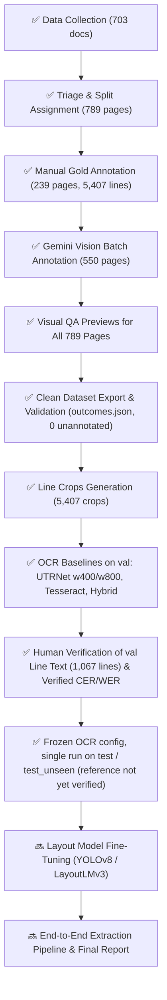

# Nastaliq Document Intelligence — Complete Project Documentation

> **Course Project — Group 2**
> **Stage:** Data Collection, Triage, and Ground-Truth Annotation ✅ Complete · Line OCR baselines on val ✅ · Human verification of val line text ✅ (1,067 lines) · Verified OCR evaluation on val ✅
> **Date:** November 2026

---

## 1. Project Goal

Build a pipeline that takes a **scanned / photographed Urdu notice** (written in Nastaliq script) and extracts four structured fields:

| Field | Example |
|---|---|
| Department name | آزاد جموں وکشمیر انٹر میڈیٹ و ثانوی تعلیمی بورڈ میرپور |
| Reference number | 8389-8400 / 2026 |
| Date | 12-11-2026 |
| Subject | پریس ریلیز! |

The pipeline also locates every region on the page (body text, table, stamp, distribution list) so a user can see **where** each value came from.

**Four evaluation metrics** will measure the final pipeline:

| Metric | Measures |
|---|---|
| Layout mAP@0.5 | Did the layout model find the right boxes? |
| Field F1 | Did the pipeline extract the correct text values? |
| OCR CER | Character-level accuracy of the OCR stage |
| OCR WER | Word-level accuracy of the OCR stage |

---

## 2. Data Sources

### 2.1 AJK BISE (Primary Source)
- **Who:** Azad Jammu & Kashmir Board of Intermediate and Secondary Education, Mirpur
- **What:** Notices, press releases, and notifications published on [ajkbise.net](https://ajkbise.net)
- **Downloaded with:** `download_ajkbise.py` — a custom scraper that walks the AJK BISE website, downloads each document, computes its SHA-256 hash, and writes `Dataset/ajkbise_manifest.csv`
- **Volume:** **691 unique source files** (430 images + 255 PDFs + 6 other)
- **Years covered:** 2010 – 2026 (bulk: 2016 – 2026)
- **Document types:** Phone-camera photos (WhatsApp, CamScanner), flatbed scans, and a small number of native-digital PDFs

### 2.2 FBR (Secondary / Unseen-Issuer Source)
- **Who:** Federal Board of Revenue, Government of Pakistan
- **What:** 12 official SRO (Statutory Regulatory Order) notifications in Urdu
- **Format:** Clean digital-born PDFs (created in Microsoft Word or similar)
- **Purpose:** Test the pipeline on a **completely different issuer** — different layout, different vocabulary, digital rather than scanned

### 2.3 Totals before deduplication

| Source | Files | Pages after rendering |
|---|---|---|
| AJK BISE | 691 | 759 |
| FBR | 12 | 30 |
| **Combined** | **703** | **789** |

---

## 3. Stage 1 — Data Collection (`download_ajkbise.py`)

```
download_ajkbise.py
│
├── Scrapes ajkbise.net notification listing pages
├── Downloads each file (JPG, PDF, PNG) with its metadata
├── Computes SHA-256 hash of each file
└── Writes Dataset/ajkbise_manifest.csv
     Columns: file_name, date, title, format, category, source_url, sha256
```

**Output:** `Dataset/ajkbise_manifest.csv` — 691 rows, one per source document, with the original website publish date and title in English.

---

## 4. Stage 2 — Triage & Page Rendering (`triage.py`)

### What it does

Reads every PDF and image in `Dataset/DOCS-PDFS/` and:

1. **Renders PDFs to images** at 300 DPI using `pypdfium2`
2. **Classifies capture type** for every page:
   - `photo` — phone camera (detected via EXIF make/model, or filename words: `whatsapp`, `camscanner`, `img_`, etc.)
   - `scan` — flatbed scanner
   - `digital` — PDF with a real Urdu text layer (≥ 50 Urdu Unicode characters extracted by `pypdf`)
3. **Detects near-duplicates** — pages with the same notice saved twice are identified using perceptual hashing (16×16 average hash, Hamming distance ≤ 12) and kept in the same split
4. **Assigns train/val/test splits** at the **document level** (never the page level), so no document straddles two splits:
   - FBR → `test_unseen`
   - AJK newest documents → `test` (~50 pages, type-balanced)
   - AJK next newest → `val` (~30 pages)
   - Older AJK → `train`
5. **Marks pages for annotation** (`annotate=1`): all evaluation pages (test, val, test_unseen) + a type-balanced sample of train pages, up to 250 total
6. **Flags personal data** — file names containing "slip", "result", "noc", "certificate" etc. go into `review_personal_data.csv` for manual checking before annotation

### Output files

| File | Description |
|---|---|
| `pages/images/*.png` | 789 rendered page images |
| `pages/manifest.csv` | 789 rows — page_id, image path, capture type, year, split, annotate flag |
| `pages/review_personal_data.csv` | 45 files flagged for personal data review |

### Dataset split summary

| Split | Pages | Purpose |
|---|---|---|
| train | 675 | Layout model training, few-shot prompt examples |
| val | 32 | Prompt tuning and threshold calibration |
| test | 52 | **Final evaluation (AJK)** |
| test_unseen | 30 | **Final evaluation (FBR — different issuer)** |

### Capture type breakdown

| Type | Pages | Description |
|---|---|---|
| photo | 409 (52%) | Phone photos — variable angle, lighting, blur |
| scan | 350 (44%) | Flatbed scans — cleaner but older/faded |
| digital | 30 (4%) | FBR PDF text layer — no OCR needed |

---

## 5. Stage 3 — Task Creation (`make_tasks.py`)

Takes the 250 pages marked `annotate=1` from the manifest and builds `tasks.json` for Label Studio.

- **11 pages excluded** — their source files appeared in `review_personal_data.csv` (personal data flag); excluded without `--include-flagged`
- **239 final tasks** created
- **120 pages marked pass2=1** — these get a second annotation pass where every text line is transcribed (for CER/WER measurement)
- Task ordering: test → test_unseen → val → train (evaluation pages done first)

Each task carries:
```json
{
  "page_id": "AJK_0001_p01",
  "split": "train",
  "type": "photo",
  "pass2": 1
}
```

---

## 6. Stage 4 — Manual Annotation (Label Studio)

### Label Studio Setup

**Interface:** `labelstudio_config.xml`
- **9 layout labels** (rectangle boxes): `header_department`, `reference_no`, `date`, `subject`, `body`, `table`, `stamp_signature`, `distribution_list`, `text_line`
- **Per-box textarea** for typing the exact text inside each field box
- **Per-box flags**: `handwritten`, `implicit_subject`, `auto_heuristic`
- **Page-level flags**: `no_date`, `no_reference_no`, `no_subject`, `contains_personal_data`, `skip_bad_image`

**Guide:** `annotation_guide.md` — step-by-step instructions for annotators

### Annotation Rules

| Box type | Action |
|---|---|
| `header_department` | Box around department header + type the exact Urdu text |
| `date` | Box around date text + type it (e.g. `12-11-2026`) |
| `reference_no` | Box around reference number + type it |
| `subject` | Box around subject/title line + type it; flag `implicit_subject` if inferred |
| `body` | Box only — no text required |
| `table` | Box only |
| `stamp_signature` | Box only |
| `distribution_list` | Box only |
| `text_line` (Pass 2) | Box around every text line + type that exact line in Urdu |

### Gold Annotation Results (`export.json`)

239 manually annotated and verified pages:

```
pages written: 239
warnings: 0

Field presence:
  department    present: 239 / 239  (100%)
  date          present: 195 / 239  (82%)  |  marked absent: 44
  subject       present: 203 / 239  (85%)  |  marked absent: 36
  reference_no  present: 167 / 239  (70%)  |  marked absent: 72

Boxes by label:
  header_department : 239
  subject           : 203
  date              : 195
  reference_no      : 167
  body              : 1,634
  table             : 121
  stamp_signature   : 384
  distribution_list : 159
  text_line         : 5,407  (Pass 2 — line transcriptions)

Box flags:
  implicit_subject     : 203 (all subject boxes — inferred from document type)
  handwritten (ref_no) : 155
  handwritten (date)   : 162
```

**Pass 2 — Line Transcription (CER/WER ground truth):**
- 120 pages have all text lines individually boxed and transcribed
- 5,407 Urdu Nastaliq text line images with transcribed text
- Note: a later human review (§12.5) found this line text largely uncorrected machine OCR; 80% of the verified
  val lines needed correction. Use `data/annotations/verified_lines.tsv` as the reference for OCR evaluation.

---

## 7. Stage 5 — Earlier Automated Labelling Attempt (Surya)

Before the manual annotation phase, the team ran **Surya** (a document layout and OCR model) automatically on the 250 annotated-target pages.

**Notebook:** `auto_label_surya.ipynb`

```
Surya Pipeline:
  1. Layout detection → 6 region types (header, title, body, table, reference, signature)
  2. OCR → text per region and per line
  3. Field extraction → date, department, subject, sro_number via regex + keyword matching
  4. YOLO label export + visual previews
```

**Result:** `nastaliq/auto_labels/auto_annotations.json` — 250 pages with "silver" labels

**Why these were NOT used as the answer key:**
> Surya was not accurate on Nastaliq script. Using a model's output as ground truth without correction means you are measuring how well your model *agrees with another model*, not how well it reads the actual text. CER would look better than it really is.

**What Surya output was used for:**
- YOLO dataset (`nastaliq/auto_labels/yolo_dataset/`) — 683 label files for layout pre-training
- Visual previews for the annotators to use as a reference starting point

---

## 8. Stage 6 — Export & Validation (`export_to_json.py`)

Converts the Label Studio `export.json` into clean per-page JSON files:

```
python export_to_json.py --export export.json --out Dataset --doc-root .
```

**Output:**

| File | Description |
|---|---|
| `Dataset/pages/<page_id>.json` | One clean JSON per page |
| `Dataset/all_pages.jsonl` | 239-line JSONL (gold pages only) |
| `Dataset/report.txt` | Validation report — 0 warnings |

**Per-page JSON structure:**
```json
{
  "page_id": "AJK_0001_p01",
  "image": "pages/images/AJK_0001_p01.png",
  "width": 2108, "height": 3197,
  "source": "AJK", "type": "photo", "split": "train",
  "page_flags": [],
  "fields": {
    "department": {
      "region_id": "reg_1",
      "text": "آزاد جموں وکشمیر انٹر میڈیٹ و ثانوی تعلیمی بورڈ میرپور",
      "bbox": [419.1, 110.0, 1284.0, 95.9],
      "flags": []
    },
    "date": { "text": "12-11-2026", "bbox": [...], "flags": ["handwritten"] },
    "reference_no": { "text": "8389-8400 / 2026", "bbox": [...], "flags": ["handwritten"] },
    "subject": { "text": "پریس ریلیز!", "bbox": [...], "flags": ["implicit_subject"] }
  },
  "regions": [
    { "label": "header_department", "bbox": [...], "text": "آزاد جموں..." },
    { "label": "body",              "bbox": [...], "text": "" },
    { "label": "stamp_signature",   "bbox": [...], "text": "" },
    { "label": "distribution_list", "bbox": [...], "text": "" }
  ]
}
```

---

## 9. Stage 7 — Visual Annotated Previews (`draw_annotations.py`)

Draws coloured bounding boxes on every page image so annotators and reviewers can visually verify the annotations.

**Color scheme:**

| Label | Color |
|---|---|
| `header_department` | 🔵 Blue |
| `reference_no` | 🔴 Red |
| `date` | 🟢 Green |
| `subject` | 🟠 Orange |
| `body` | ⬜ Gray |
| `table` | 🟣 Purple |
| `stamp_signature` | 🩵 Teal |
| `distribution_list` | 🩷 Mauve |
| `text_line` | 💙 Light Blue |

**Output:** `pages/annotated_previews/` — 239 gold preview PNGs (labelled **GOLD**)

---

## 10. Stage 8 — Gemini Vision Annotation Engine (`gemini_batch_annotate.py`)

### 10.1 Background & Need for Vision-Based Annotation
Initially, two approaches were evaluated for the remaining 550 auto-pages:
1. **Surya OCR (`auto_label_surya.ipynb`):** Failed heavily on Nastaliq script — corrupted Urdu character glyphs (replacing Urdu `ی/ک` with Arabic `ي/ك`), merged lines erratically, and misclassified body paragraphs as header dates.
2. **Geometric Ink-Density Heuristics (`auto_annotate_remaining.py`):** Produced rigid, approximate geometric bands (e.g., top 12% for department) that lacked precise boundaries around skewed or irregular document structures.

To produce a production-grade benchmark, we implemented a custom batch annotation pipeline powered by Google's **Gemini Vision API** (`gemini-3.5-flash-lite` and `gemini-3-flash-preview`).

### 10.2 Architecture & Implementation Features
- **Prompt Engineering for Nastaliq Layout:** Instructs the vision model to detect 9 official classes (`header_department`, `subject`, `date`, `reference_no`, `table`, `body`, `stamp_signature`, `distribution_list`) and output normalized 0–1000 integer coordinates `[ymin, xmin, ymax, xmax]` alongside verbatim Urdu text.
- **Dual-Key Rotation & Quota Management:** Automatically switches between active API keys and falls back to alternate Flash models when 429 rate limits or daily quotas are reached.
- **Resumable Local Caching:** Raw Gemini Vision JSON outputs are cached per page in `data/annotations/gemini_cache/<page_id>.json`. If interrupted, the pipeline skips existing items without consuming redundant API tokens.
- **Label Studio Format Translation:** Maps detected normalized boxes to Label Studio `rectanglelabels` percentages, clamps out-of-bound coordinates, attaches extracted Urdu strings to `textarea` results, and applies default field flags (`implicit_subject`, `handwritten`).
- **Visual Preview Generation:** Concurrently draws color-coded bounding boxes and label tags onto each document image and saves the preview to `data/previews/<page_id>_annotated.png`.

**Output:** 550 high-precision annotated tasks merged with the 239 gold tasks to yield a complete 789-task ground truth.

---

## 11. Final Dataset Summary

### Unified Repository Layout

```
Nastaliq-Document-Intelligence/
│
├── README.md                           # Main repository readme
├── PROJECT_DOCUMENTATION.md            # Comprehensive project documentation
├── requirements.txt                    # Python environment specifications
├── configs/
│   └── labelstudio_config.xml          # Label Studio interface schema (9 classes + flags)
├── docs/
│   └── annotation_guide.md             # Annotation guide and tagging conventions
├── scripts/
│   ├── paths.py                        # Path constants across the project
│   ├── download_ajkbise.py             # AJK BISE scraper
│   ├── triage.py                       # Rendering, capture classification, splitting
│   ├── make_tasks.py                   # Label Studio task packaging
│   ├── gemini_batch_annotate.py        # Gemini Vision API annotation & preview engine
│   ├── build_clean_annotations.py      # Urdu dictionary & regex normalization rules
│   ├── draw_annotations.py             # Visual preview generator
│   ├── export_to_json.py               # Validation, evidence linking & export pipeline (+ line crops)
│   ├── ocr_utrnet.py                   # UTRNet-Large line OCR (separate venv)
│   ├── ocr_tesseract.py                # Tesseract 5 line OCR
│   ├── postprocess_ocr.py              # Reading-order fix for UTRNet date / number lines
│   ├── combine_ocr.py                  # UTRNet + Tesseract hybrid routing
│   ├── eval_ocr.py                     # OCR metrics, breakdowns, suspect-reference filter
│   ├── test_eval_ocr.py                # 14 metric / rule checks
│   ├── make_review_sheet.py            # Human-verification sheets for line text
│   └── merge_review.py                 # Merge reviews, reviewer agreement, adjudication
├── results/ocr/                        # OCR predictions, run summaries and evaluation reports
├── third_party/                        # Git-ignored: UTRNet code + weights, Tesseract models
├── data/
│   ├── raw/
│   │   ├── documents/
│   │   │   ├── azad Kashmir/           # 672 AJK source files (images & PDFs)
│   │   │   └── FBR/                    # 12 FBR digital Urdu SROs
│   │   ├── ajkbise_manifest.csv        # 691 source metadata records
│   │   └── scrape_failed.csv           # Scrape log
│   ├── interim/
│   │   ├── images/                     # 789 rendered high-res PNG pages
│   │   ├── manifest.csv                # 789 rows with capture types and splits
│   │   └── review_personal_data.csv    # Privacy check log (0 PII leaks)
│   ├── annotations/
│   │   ├── tasks.json                  # 239 Label Studio import tasks
│   │   ├── export.json                 # Complete 789 tasks (Gold + Gemini Vision)
│   │   ├── export_full.json            # 789 tasks master archive
│   │   └── gemini_cache/               # 550 raw Gemini Vision JSON detections
│   ├── processed/
│   │   ├── pages/                      # 789 per-page structured JSON records
│   │   ├── all_pages.jsonl             # 789 JSON Lines records
│   │   ├── outcomes.json               # 789 records array (outcomes format)
│   │   ├── report.txt                  # Official validation report (0 unannotated)
│   │   ├── lines.tsv                   # 5,407 transcribed text lines with crop path and bbox
│   │   └── lines/                      # Line crop PNGs (git-ignored, regenerable)
│   ├── review/                         # Reviewed val sheets b1–b3 + manifest
│   └── previews/                       # 789 visual preview PNGs with color boxes
└── build/                              # Packaging artefacts
```

### Verified Dataset Metrics

| Metric | Target | Verified Value |
|---|---|---|
| Total Source Documents | 703 | 703 (691 AJK + 12 FBR) |
| Total Rendered Pages | 789 | 789 |
| Gold Human-Verified Pages | 239 | 239 |
| Gemini Vision Annotated Pages | 550 | 550 |
| Total Annotated Tasks in `export.json` | 789 | **789 / 789 (100%)** ✅ |
| Total Visual Previews Generated | 789 | **789 (`data/previews/`)** ✅ |
| Pages Not Annotated Yet | 0 | **0** ✅ |
| Personal Data Excluded | 0 | **0** ✅ |
| Total Detected Layout Boxes | — | **11,765 boxes** |
| Total Transcribed Text Lines | — | **5,407 lines** |

### Breakdown of Detected Labels Across All 789 Pages

| Label Class | Box Count | Description / Role |
|---|---|---|
| `header_department` | 744 | Top official issuing authority header |
| `subject` | 703 | Notice subject / title (پریس ریلیز!, نوٹیفکیشن!) |
| `reference_no` | 663 | Dispatch & file reference numbers |
| `date` | 616 | Notification issue dates |
| `body` | 2,380 | Document body paragraphs |
| `table` | 362 | Fee schedules, date sheets, structured grids |
| `stamp_signature` | 898 | Official stamps and signatory designations |
| `distribution_list` | 702 | Bottom dispatch / carbon copy (نقل برائے) lists |
| `text_line` | 5,407 | Individual transcribed text lines |

### Split × Quality Matrix

| Split | Gold Verified | Gemini Vision | Total Pages | Split Purpose |
|---|---|---|---|---|
| `train` | 129 | 546 | 675 | Model training & few-shot fine-tuning |
| `test` | 49 | 3 | 52 | Final benchmark evaluation |
| `val` | 31 | 1 | 32 | Hyperparameter tuning & validation |
| `test_unseen` | 30 | 0 | 30 | Generalization benchmark (FBR unseen issuer) |
| **Total** | **239** | **550** | **789** | **Complete Dataset** |

---

## 12. Stage 9 — Line OCR Baselines & Evaluation

This stage measures how well existing OCR engines read the line crops. Every choice (engine, input width,
routing) was made on the 1,437 **val** lines and frozen (`results/ocr/frozen_config.json`) before `test` and
`test_unseen` were run once (§12.8).

### 12.1 Line crops

`export_to_json.py --crops` cuts every `text_line` box into its own image and writes `data/processed/lines.tsv`
(crop path, page, split, capture type, `region_id`, `bbox`, text): 5,407 lines in total. Only 601 lines are in
`train` (10 pages), too few to fine-tune an OCR model, so this stage evaluates pretrained engines.

### 12.2 OCR engines

| Engine | Script | Notes |
|---|---|---|
| **UTRNet-Large** (ICDAR 2023, HRNet + DBiLSTM + CTC) | `ocr_utrnet.py` | Pretrained on printed Urdu; CC BY-NC-SA (non-commercial). CPU inference, own venv. Input height 32 px, width 400 (trained) or 800. |
| **Tesseract 5.4** (`tessdata_best` 4.1.0) | `ocr_tesseract.py` | `urd+eng` and `eng` models, single-line mode (`--psm 7`). Deterministic. |
| **Hybrid (final, frozen)** | `combine_ocr.py` | Uses Tesseract `eng` when UTRNet's output has no Urdu letter (rule A), or when Tesseract's mean word confidence is ≥ 70 and it read a Latin letter or digit (rule B). Decided from predictions, never from the reference. |

**UTRNet is not deterministic by default.** At test time it averages 5 passes with random "temporal dropout"
masks, one mask per batch, so a line's output depends on its batch and on how the run was split. Two identical
runs agreed on only 10 of 30 lines. `--per-line-seed` reseeds the random generator from each crop's name
(batch size 1, same speed on CPU). Each prediction then depends only on (line, seed, width), and resumed or
repeated runs are identical (verified 30/30). All comparisons below use this mode.

### 12.3 Evaluation method (`eval_ocr.py`)

- **Metrics:** CER and WER (micro-averaged), CER without spaces (Urdu word spacing is inconsistent even in the
  gold), per-line NED, exact-match rate, and substitution / deletion / insertion shares.
- **Breakdowns:** split, capture type (photo / scan), line category (`urdu`, `num_latin` = no Urdu letters,
  `hw_field` = inside a handwritten date / reference box, which is a position rule, not a verified writing
  style), content (Urdu only, Urdu + digits, digits only, Latin only, ...) and aspect ratio. Every system is
  scored on exactly the same lines.
- **Normalisation:** Arabic yeh/kaf/heh → Urdu forms, Urdu/Arabic digits → ASCII, diacritics and tatweel dropped.
- **Suspect references:** lines whose reference contains Chinese/Japanese/Korean characters, or 5+ characters
  with no letter or digit, are excluded (5 on val) and listed in the report for reviewers. This is a heuristic,
  not proof the reference is wrong. The report header accounts for every line:
  1,437 = 1,432 scored + 5 suspect.
- **Postprocessing (`postprocess_ocr.py`):** on lines with only digits and punctuation, UTRNet emits a date's
  digit groups in reverse (`2021-12-10` for a printed `10-12-2021`). These are put back in logical order and
  list markers are left in reading order (`5-` for a printed `-5`). The effect on val is small: 12 lines change,
  9 better, 3 worse, overall CER unchanged. An earlier version also moved list markers; its apparent large gain
  came only from matching the old gold's marker convention, so it was withdrawn.
- **Tests:** `test_eval_ocr.py` runs 14 checks of the metrics and rules; all pass.

### 12.4 Results on val (preliminary: original, unverified reference text)

| System | Overall CER | Printed Urdu (960 lines) | Numbers / English (367 lines) | Handwritten-field lines (105) |
|---|---|---|---|---|
| UTRNet-Large, width 400 | 23.2% | 21.6% | 77.8% | 22.9% |
| UTRNet-Large, width 800 | 21.3% | 19.7% | 78.0% | 20.4% |
| Tesseract `urd+eng` | 70.7% | 72.5% | 36.4% | 63.9% |
| Tesseract `eng` | 89.5% | 91.8% | 26.7% | 86.0% |
| **Hybrid (UTRNet w800 + Tesseract `eng`)** | **20.4%** | **19.7%** | **45.4%** | **19.6%** |

Within printed Urdu, UTRNet at width 400 scores 18.1% CER on Urdu-only lines, 22.9% on Urdu + digits and 27.2% on
Urdu + English. Photo and scan pages differ by less than one point.

**Input width (paired, identical lines, page-level bootstrap):**

| Printed Urdu lines by width/height | Lines | w800 − w400 CER | 95% CI | Lines better / worse |
|---|---|---|---|---|
| ≤ 12.5 (fits 400 px) | 543 | −0.04 pts | −0.15 to +0.09 | 58 / 54 |
| 12.5 – 25 | 315 | −1.72 pts | −2.22 to −1.18 | 183 / 78 |
| > 25 | 102 | −4.59 pts | −5.10 to −4.12 | 97 / 3 |

Width 800 helps exactly the lines that width 400 squeezes horizontally, and leaves the rest unchanged.

**Why UTRNet fails on numbers / English lines** (error analysis on the width-400 run):

| Cause | Evidence |
|---|---|
| Wrong reference text | 10 lines (Japanese text for Urdu images, punctuation rows) caused 20% of the category's errors |
| Reading order | UTRNet reads right to left; marks and digit groups on non-Urdu lines come out reversed |
| Real recognition weakness | English is often turned into Urdu-like shapes (51% of English-line outputs contain Urdu letters); small printed dates are misread; digits inside Urdu lines are only ~53% correct |

### 12.5 Reference-text quality and human verification

The `text_line` gold came largely from machine transcription and contains errors. The fixed printed header is
misspelled (`بورذ`, `میذینث`, `جمول`; `تشمیر` in 94 lines), 71 of 120 line-transcribed pages show OCR-style mistakes,
9 lines contain Japanese text, and 28 lines are CamScanner watermarks. Every CER above therefore mixes model
errors with reference errors.

Verification workflow (`make_review_sheet.py` → reviewers → `merge_review.py` → `eval_ocr.py --verified`):

- Four Excel sheets (`data/review/val_review_b1–b4.xlsx`) show the crop image, the original gold and the UTRNet
  prediction. Every line is reviewed, not only disagreements, to avoid biasing the evaluation towards UTRNet.
- 80 lines are reviewed by two people. The merge reports agreement %, keep/drop kappa and inter-reviewer CER.
  Conflicts go to an adjudication sheet.
- Statuses: `gold_ok`, `utrnet_ok`, `corrected`, `exclude`, `illegible`. The original gold and raw predictions
  are never edited. A manifest records the dataset hash and git commit.
- Transcription rules include reading order (`-5` printed → typed `5-`), telling `۔` from `-`, and always
  correcting garbage gold.
- The verified evaluation reports two things separately: the **annotation error rate** (original gold vs
  verified text) and the **OCR error rate** (each system vs verified text).

**Review outcome (val):**

| Batch | Lines | Used | Notes |
|---|---|---|---|
| b1, b2 | 372 + 381 | yes | reviewer: toqir dar |
| b3 | 379 | yes | reviewer recorded only as "Reviewer" |
| b4 | 385 | **no** | 316 of 358 "corrected" rows were UTRNet's output copied unchecked, e.g. `۹۹۔` for `11۔`, `(6660)` for `(IBCC)`, a garbled URL for `www.ajkbise.edu.pk`; not committed |

- `data/annotations/verified_lines.tsv`: **1,067 usable verified lines** (172 `gold_ok`, 74 `utrnet_ok`,
  821 `corrected`), 12 excluded or illegible, 15 unresolved conflicts (not scored), 343 unreviewed b4 lines.
- Agreement (`review_agreement.json`): 38 lines reviewed by two people; 60.5% identical after normalisation,
  2.3% CER between the two reviewers. Most disagreements are punctuation (`۔` vs `-`, quote style) or spacing.
- An attempt to let the Gemini API review the sheets was tested and dropped: the free-tier quota allowed 20
  requests per day on the stronger model, and the weaker free model accepted wrong text as exact in trials.

### 12.6 Results on human-verified val

All systems scored on the same 1,067 verified lines (`results/ocr/final_val_verified.report.md`).

| System | CER | WER | Exact lines |
|---|---|---|---|
| UTRNet-Large, width 400 | 17.7% | 64.5% | 13.7% |
| UTRNet-Large, width 800 | 15.2% | 54.5% | 13.6% |
| Tesseract `urd+eng` | 70.6% | 95.6% | 7.8% |
| Tesseract `eng` | 89.9% | 100.0% | 8.0% |
| Hybrid w800, rule A only | 14.8% | 54.1% | 17.4% |
| **Final hybrid (frozen), rules A + B** | **14.5%** | **53.8%** | **18.1%** |
| *Original gold (annotation error rate)* | *16.2%* | *52.4%* | *19.6%* |

| Content | Lines | UTRNet w800 | Hybrid rule A | **Final hybrid** | Tesseract `eng` | Original gold |
|---|---|---|---|---|---|---|
| Urdu only | 430 | **10.4%** | 10.4% | 10.4% | 93.7% | 15.6% |
| Urdu + digits | 267 | 14.7% | 14.5% | 14.5% | 90.1% | 17.2% |
| Urdu + English | 100 | 19.7% | 19.7% | 19.7% | 88.9% | 15.2% |
| Digits only | 218 | 59.9% | 40.0% | 40.0% | **37.5%** | 30.6% |
| English only | 51 | 80.6% | 70.1% | 42.3% | **22.9%** | 2.5% |

| UTRNet-Large by width/height | Lines | Width 400 | Width 800 |
|---|---|---|---|
| ≤ 12.5 | 712 | 21.6% | 21.4% |
| 12.5–25 | 276 | 16.2% | 13.7% |
| > 25 | 79 | 16.3% | **10.9%** |

Findings:
1. **Annotation quality (Evaluation A):** reviewers changed 858 of 1,067 lines (80%); the original gold has 16.2%
   CER against the verified text and is exactly right on 19.6% of lines.
2. **OCR quality (Evaluation B):** UTRNet-Large at width 800 reaches 15.2% CER overall and 10.4% on Urdu-only
   lines. Against the unverified gold the same model scored 21.3%; most of that gap was reference error.
3. **Width 800 is the better setting:** it fixes the squeezing of long lines and leaves short lines unchanged.
4. **Hybrid:** Tesseract is much better on digit-only and English-only lines. Rule A alone still sent most
   English-only lines to UTRNet (70.1%). Rule B (Tesseract confidence ≥ 70) brings them to 42.3% and leaves every
   Urdu group unchanged, so the final hybrid is best (14.5%). Thresholds 60–80 were within 0.1 point overall.
   Routing on Tesseract `urd+eng`'s script was rejected: it reads 90 of 430 Urdu-only lines with no Urdu letter.
5. **Capture type:** little difference (UTRNet w800 14.8% on 711 photo lines, 16.1% on 356 scan lines).

Limitations: 343 b4 lines unverified and 15 conflicts unresolved; agreement rests on 38 lines; reviewers saw
UTRNet's width-400 output, so UTRNet's scores may be slightly optimistic; results are on val only.

Headline wording: *UTRNet-Large achieved 15.2% CER on 1,067 human-verified validation lines, including 10.4%
on Urdu-only lines; the frozen hybrid with Tesseract for digit and English lines achieved 14.5%.*

### 12.7 Practical notes

- UTRNet runs at about 0.7 s per line at width 400 and about 2.4 s per line at width 800 on CPU. Tesseract runs
  at about 0.3–0.4 s per line.
- The UTRNet venv is machine-specific and has to be rebuilt per PC (README). A venv rebuilt on Python 3.14
  with the same torch 2.15.0+cpu / numpy 2.5.5 / pillow 13.0.0 reproduced 30 of 30 val predictions exactly. On one machine, 208 line crops were
  corrupted on disk. They were rebuilt with `export_to_json.py --crops` after checking that all 5,199 intact
  crops rebuild byte-identical.
- Engine outputs follow different conventions on lines without Urdu: Tesseract writes `-5` (visual,
  left to right), while UTRNet and the review rules use `5-` (reading order). On verified text Tesseract still
  wins on digit-only lines (37.5% vs 59.9%).

### 12.8 Frozen configuration: single run on test / test_unseen

The configuration (`results/ocr/frozen_config.json`: UTRNet-Large width 800 with per-line seed, Tesseract `eng`,
hybrid rules A + B) was frozen on verified val, then run once on `test` (2,546 lines) and `test_unseen` (823 lines,
FBR). Nothing was changed afterwards. The line text of these splits is **not yet verified**, so the scores below use
the original annotation. On val, that reference made UTRNet w800 look about 21% CER where verified text gave 15.2%,
so these are upper bounds. Reports: `results/ocr/final_test_unverified.report.md`,
`results/ocr/final_test_unseen_unverified.report.md`.

| System (CER, unverified reference) | test | test_unseen |
|---|---|---|
| UTRNet-Large w800 | 25.6% | 17.7% |
| Tesseract `urd+eng` | 70.0% | 67.1% |
| Tesseract `eng` | 87.8% | 88.3% |
| **Final hybrid** | **23.1%** | **16.4%** |

- The frozen hybrid is best on both splits. Urdu groups are unchanged by routing (Urdu-only: test 17.9%,
  test_unseen 7.4%).
- On digit-only / English-only lines the hybrid (20–26%) is far better than UTRNet (62–89%) but still 3–11 points
  behind Tesseract alone. Some such lines get a few Urdu letters from UTRNet and a Tesseract confidence below 70.
  This gap is reported, not tuned on test.
- The UTRNet test runs used a venv rebuilt on this machine. It reproduced 30/30 val predictions exactly.

### 12.9 Next steps

1. Fill the prepared sheets: `data/review/val_adjudication_b1.xlsx` (15 conflicts; read the two reviews in
   `data/annotations/review_conflicts.tsv`) and `data/review/val_rereview_b4_b1.xlsx` (343 lines).
2. Verify the `test` line text with the prepared sheets (7 files, 140 lines double-reviewed; rebuild them with the
   command in the README, as the `.xlsx` files are not in git), then `test_unseen`. Rescore the existing prediction
   files with `eval_ocr.py --verified`, without re-tuning.
3. Decide whether fine-tuning is worthwhile. This needs more training lines than the current 601.

---

## 13. What the Ground-Truth Answer Key Enables

| Ground Truth Component | What It Measures | Target Evaluation Metric |
|---|---|---|
| Bounding boxes for all 9 layout classes | Precision of document structure segmentation | **Layout mAP@0.5** |
| 4 key fields (`department`, `ref_no`, `date`, `subject`) | Accuracy of structured information extraction | **Field F1 Score** |
| Evidence linking (`bbox` + `region_id` per field) | Human auditability — verifying the provenance of extracted values | **Extraction Interpretability** |
| Pass-2 line transcription (`lines.tsv`, 5,407 lines) | Raw OCR accuracy on complex Nastaliq calligraphy | **CER (Character Error Rate) & WER** |
| Post-OCR LLM normalization | Error recovery rate of LLM post-processing vs raw OCR | **Delta CER / Normalized CER** |

---

## 14. Project Status & Roadmap



| Pipeline Stage | Status | Notes |
|---|---|---|
| 1. Data Collection | ✅ Complete | 672 AJK BISE notices + 12 FBR SROs |
| 2. Triage & Rendering | ✅ Complete | 789 pages rendered at 300 DPI, capture type classified |
| 3. Gold Annotation | ✅ Complete | 239 pages manually labeled and line-transcribed |
| 4. Gemini Vision Annotation | ✅ Complete | 550 auto-pages annotated with Gemini 3.5 Flash Lite Vision |
| 5. Visual QA Previews | ✅ Complete | 789 color-coded preview overlays in `data/previews/` |
| 6. Validation & Export | ✅ Complete | `export.json`, `outcomes.json`, `all_pages.jsonl`, `report.txt` |
| 7. Line Crops Generation | ✅ Complete | 5,407 crops + `lines.tsv` (`export_to_json.py --crops`) |
| 8. OCR Baselines (val) | ✅ Complete | UTRNet-Large w400/w800 (deterministic), Tesseract, hybrid (§12) |
| 9. Line-Text Verification (val) | ✅ Complete | 1,067 verified lines (b1–b3); b4 excluded; 15 conflicts open (§12.5) |
| 9b. Verified OCR Evaluation (val) | ✅ Complete | UTRNet w800 15.2% CER (10.4% Urdu-only), final hybrid 14.5%, original gold 16.2% (§12.6) |
| 9c. Frozen OCR config + test run | ✅ Complete | Hybrid 23.1% (test) / 16.4% (test_unseen) vs unverified reference (§12.8) |
| 9d. Test line-text verification | 🔜 Planned | Sheets prepared for `test`; then rescore with `--verified` (§12.9) |
| 10. Layout Model Training | 🔜 Planned | YOLO / LayoutLMv3 on 11,765 layout boxes |
| 11. Field Extraction & Metrics | 🔜 Planned | Field F1 & Layout mAP evaluation; final test-set OCR run |

---

*Updated: November 2026 — Nastaliq Document Intelligence, Group 2*
