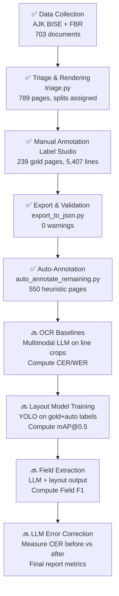

# Nastaliq Document Intelligence — Complete Project Documentation

> **Course Project — Group 2**
> **Stage:** Data Collection, Triage, and Ground-Truth Annotation ✅ Complete
> **Date:** November 2026

---

## 1. Project Goal

Build a pipeline that takes a **scanned / photographed Urdu notice** (written in Nastaliq script) and extracts four structured fields:

| Field | Example |
|---|---|
| Department name | آزاد جموں وکشمیر انٹر میڈیٹ و ثانوی تعلیمی بورڈ میرپور |
| Reference number | 8389-8400 / 2026 |
| Date | 12-11-2026 |
| Subject | پریس ریلیز! |

The pipeline also locates every region on the page (body text, table, stamp, distribution list) so a user can see **where** each value came from.

**Four evaluation metrics** will measure the final pipeline:

| Metric | Measures |
|---|---|
| Layout mAP@0.5 | Did the layout model find the right boxes? |
| Field F1 | Did the pipeline extract the correct text values? |
| OCR CER | Character-level accuracy of the OCR stage |
| OCR WER | Word-level accuracy of the OCR stage |

---

## 2. Data Sources

### 2.1 AJK BISE (Primary Source)
- **Who:** Azad Jammu & Kashmir Board of Intermediate and Secondary Education, Mirpur
- **What:** Notices, press releases, and notifications published on [ajkbise.net](https://ajkbise.net)
- **Downloaded with:** `download_ajkbise.py` — a custom scraper that walks the AJK BISE website, downloads each document, computes its SHA-256 hash, and writes `Dataset/ajkbise_manifest.csv`
- **Volume:** **691 unique source files** (430 images + 255 PDFs + 6 other)
- **Years covered:** 2010 – 2026 (bulk: 2016 – 2026)
- **Document types:** Phone-camera photos (WhatsApp, CamScanner), flatbed scans, and a small number of native-digital PDFs

### 2.2 FBR (Secondary / Unseen-Issuer Source)
- **Who:** Federal Board of Revenue, Government of Pakistan
- **What:** 12 official SRO (Statutory Regulatory Order) notifications in Urdu
- **Format:** Clean digital-born PDFs (created in Microsoft Word or similar)
- **Purpose:** Test the pipeline on a **completely different issuer** — different layout, different vocabulary, digital rather than scanned

### 2.3 Totals before deduplication

| Source | Files | Pages after rendering |
|---|---|---|
| AJK BISE | 691 | 759 |
| FBR | 12 | 30 |
| **Combined** | **703** | **789** |

---

## 3. Stage 1 — Data Collection (`download_ajkbise.py`)

```
download_ajkbise.py
│
├── Scrapes ajkbise.net notification listing pages
├── Downloads each file (JPG, PDF, PNG) with its metadata
├── Computes SHA-256 hash of each file
└── Writes Dataset/ajkbise_manifest.csv
     Columns: file_name, date, title, format, category, source_url, sha256
```

**Output:** `Dataset/ajkbise_manifest.csv` — 691 rows, one per source document, with the original website publish date and title in English.

---

## 4. Stage 2 — Triage & Page Rendering (`triage.py`)

### What it does

Reads every PDF and image in `Dataset/DOCS-PDFS/` and:

1. **Renders PDFs to images** at 300 DPI using `pypdfium2`
2. **Classifies capture type** for every page:
   - `photo` — phone camera (detected via EXIF make/model, or filename words: `whatsapp`, `camscanner`, `img_`, etc.)
   - `scan` — flatbed scanner
   - `digital` — PDF with a real Urdu text layer (≥ 50 Urdu Unicode characters extracted by `pypdf`)
3. **Detects near-duplicates** — pages with the same notice saved twice are identified using perceptual hashing (16×16 average hash, Hamming distance ≤ 12) and kept in the same split
4. **Assigns train/val/test splits** at the **document level** (never the page level), so no document straddles two splits:
   - FBR → `test_unseen`
   - AJK newest documents → `test` (~50 pages, type-balanced)
   - AJK next newest → `val` (~30 pages)
   - Older AJK → `train`
5. **Marks pages for annotation** (`annotate=1`): all evaluation pages (test, val, test_unseen) + a type-balanced sample of train pages, up to 250 total
6. **Flags personal data** — file names containing "slip", "result", "noc", "certificate" etc. go into `review_personal_data.csv` for manual checking before annotation

### Output files

| File | Description |
|---|---|
| `pages/images/*.png` | 789 rendered page images |
| `pages/manifest.csv` | 789 rows — page_id, image path, capture type, year, split, annotate flag |
| `pages/review_personal_data.csv` | 45 files flagged for personal data review |

### Dataset split summary

| Split | Pages | Purpose |
|---|---|---|
| train | 675 | Layout model training, few-shot prompt examples |
| val | 32 | Prompt tuning and threshold calibration |
| test | 52 | **Final evaluation (AJK)** |
| test_unseen | 30 | **Final evaluation (FBR — different issuer)** |

### Capture type breakdown

| Type | Pages | Description |
|---|---|---|
| photo | 409 (52%) | Phone photos — variable angle, lighting, blur |
| scan | 350 (44%) | Flatbed scans — cleaner but older/faded |
| digital | 30 (4%) | FBR PDF text layer — no OCR needed |

---

## 5. Stage 3 — Task Creation (`make_tasks.py`)

Takes the 250 pages marked `annotate=1` from the manifest and builds `tasks.json` for Label Studio.

- **11 pages excluded** — their source files appeared in `review_personal_data.csv` (personal data flag); excluded without `--include-flagged`
- **239 final tasks** created
- **120 pages marked pass2=1** — these get a second annotation pass where every text line is transcribed (for CER/WER measurement)
- Task ordering: test → test_unseen → val → train (evaluation pages done first)

Each task carries:
```json
{
  "page_id": "AJK_0001_p01",
  "split": "train",
  "type": "photo",
  "pass2": 1
}
```

---

## 6. Stage 4 — Manual Annotation (Label Studio)

### Label Studio Setup

**Interface:** `labelstudio_config.xml`
- **9 layout labels** (rectangle boxes): `header_department`, `reference_no`, `date`, `subject`, `body`, `table`, `stamp_signature`, `distribution_list`, `text_line`
- **Per-box textarea** for typing the exact text inside each field box
- **Per-box flags**: `handwritten`, `implicit_subject`, `auto_heuristic`
- **Page-level flags**: `no_date`, `no_reference_no`, `no_subject`, `contains_personal_data`, `skip_bad_image`

**Guide:** `annotation_guide.md` — step-by-step instructions for annotators

### Annotation Rules

| Box type | Action |
|---|---|
| `header_department` | Box around department header + type the exact Urdu text |
| `date` | Box around date text + type it (e.g. `12-11-2026`) |
| `reference_no` | Box around reference number + type it |
| `subject` | Box around subject/title line + type it; flag `implicit_subject` if inferred |
| `body` | Box only — no text required |
| `table` | Box only |
| `stamp_signature` | Box only |
| `distribution_list` | Box only |
| `text_line` (Pass 2) | Box around every text line + type that exact line in Urdu |

### Gold Annotation Results (`export.json`)

239 manually annotated and verified pages:

```
pages written: 239
warnings: 0

Field presence:
  department    present: 239 / 239  (100%)
  date          present: 195 / 239  (82%)  |  marked absent: 44
  subject       present: 203 / 239  (85%)  |  marked absent: 36
  reference_no  present: 167 / 239  (70%)  |  marked absent: 72

Boxes by label:
  header_department : 239
  subject           : 203
  date              : 195
  reference_no      : 167
  body              : 1,634
  table             : 121
  stamp_signature   : 384
  distribution_list : 159
  text_line         : 5,407  (Pass 2 — line transcriptions)

Box flags:
  implicit_subject     : 203 (all subject boxes — inferred from document type)
  handwritten (ref_no) : 155
  handwritten (date)   : 162
```

**Pass 2 — Line Transcription (CER/WER ground truth):**
- 120 pages have all text lines individually boxed and transcribed
- 5,407 Urdu Nastaliq text line images with verified ground-truth text

---

## 7. Stage 5 — Earlier Automated Labelling Attempt (Surya)

Before the manual annotation phase, the team ran **Surya** (a document layout and OCR model) automatically on the 250 annotated-target pages.

**Notebook:** `auto_label_surya.ipynb`

```
Surya Pipeline:
  1. Layout detection → 6 region types (header, title, body, table, reference, signature)
  2. OCR → text per region and per line
  3. Field extraction → date, department, subject, sro_number via regex + keyword matching
  4. YOLO label export + visual previews
```

**Result:** `nastaliq/auto_labels/auto_annotations.json` — 250 pages with "silver" labels

**Why these were NOT used as the answer key:**
> Surya was not accurate on Nastaliq script. Using a model's output as ground truth without correction means you are measuring how well your model *agrees with another model*, not how well it reads the actual text. CER would look better than it really is.

**What Surya output was used for:**
- YOLO dataset (`nastaliq/auto_labels/yolo_dataset/`) — 683 label files for layout pre-training
- Visual previews for the annotators to use as a reference starting point

---

## 8. Stage 6 — Export & Validation (`export_to_json.py`)

Converts the Label Studio `export.json` into clean per-page JSON files:

```
python export_to_json.py --export export.json --out Dataset --doc-root .
```

**Output:**

| File | Description |
|---|---|
| `Dataset/pages/<page_id>.json` | One clean JSON per page |
| `Dataset/all_pages.jsonl` | 239-line JSONL (gold pages only) |
| `Dataset/report.txt` | Validation report — 0 warnings |

**Per-page JSON structure:**
```json
{
  "page_id": "AJK_0001_p01",
  "image": "pages/images/AJK_0001_p01.png",
  "width": 2108, "height": 3197,
  "source": "AJK", "type": "photo", "split": "train",
  "page_flags": [],
  "fields": {
    "department": {
      "region_id": "reg_1",
      "text": "آزاد جموں وکشمیر انٹر میڈیٹ و ثانوی تعلیمی بورڈ میرپور",
      "bbox": [419.1, 110.0, 1284.0, 95.9],
      "flags": []
    },
    "date": { "text": "12-11-2026", "bbox": [...], "flags": ["handwritten"] },
    "reference_no": { "text": "8389-8400 / 2026", "bbox": [...], "flags": ["handwritten"] },
    "subject": { "text": "پریس ریلیز!", "bbox": [...], "flags": ["implicit_subject"] }
  },
  "regions": [
    { "label": "header_department", "bbox": [...], "text": "آزاد جموں..." },
    { "label": "body",              "bbox": [...], "text": "" },
    { "label": "stamp_signature",   "bbox": [...], "text": "" },
    { "label": "distribution_list", "bbox": [...], "text": "" }
  ]
}
```

---

## 9. Stage 7 — Visual Annotated Previews (`draw_annotations.py`)

Draws coloured bounding boxes on every page image so annotators and reviewers can visually verify the annotations.

**Color scheme:**

| Label | Color |
|---|---|
| `header_department` | 🔵 Blue |
| `reference_no` | 🔴 Red |
| `date` | 🟢 Green |
| `subject` | 🟠 Orange |
| `body` | ⬜ Gray |
| `table` | 🟣 Purple |
| `stamp_signature` | 🩵 Teal |
| `distribution_list` | 🩷 Mauve |
| `text_line` | 💙 Light Blue |

**Output:** `pages/annotated_previews/` — 239 gold preview PNGs (labelled **GOLD**)

---

## 10. Stage 8 — Auto-Annotation of Remaining 550 Pages (`auto_annotate_remaining.py`)

The 550 non-annotated training pages were auto-annotated using image-processing heuristics to give them a usable layout structure for model training.

**Approach:**
1. Load each page image (PIL)
2. Compute horizontal ink-density projection (NumPy)
3. Segment into bands:
   - Top 12% → `header_department`
   - 12–65% → `body`
   - 65–85% → `stamp_signature`
   - 85–100% → `distribution_list`
4. Add `subject` box (top-right, 70–95% width, 8–12% height)
5. Add `date` box using metadata date from `ajkbise_manifest.csv`
6. All auto-annotations tagged with `page_flags: ["auto_heuristic"]`

**Output:** 550 additional preview PNGs (labelled **AUTO**)

> [!WARNING]
> Auto-annotated pages are **approximate** — boxes are heuristic, not hand-verified.
> Use only for layout model pre-training. **Never use for evaluation.**

---

## 11. Final Dataset Summary

### File structure

```
Nastaliq-Document-Intelligence/
│
├── Dataset/
│   ├── DOCS-PDFS/
│   │   ├── azad Kashmir/        ← 672 AJK source files
│   │   └── FBR/                 ← 12 FBR PDFs
│   ├── ajkbise_manifest.csv     ← 691 rows (source docs with dates/titles)
│   ├── pages/
│   │   └── <page_id>.json       ← 239 clean per-page gold JSONs
│   ├── all_pages.jsonl          ← 239-line gold JSONL
│   ├── all_pages_full.jsonl     ← 789-line full JSONL (gold + auto)
│   └── report.txt               ← Validation: 0 warnings
│
├── pages/
│   ├── images/                  ← 789 rendered PNGs (original pages)
│   ├── annotate_images/         ← 250 images selected for annotation
│   ├── annotated_previews/      ← 789 visual preview PNGs
│   ├── manifest.csv             ← 789 rows (all pages with splits/types)
│   └── review_personal_data.csv ← 45 flagged files (personal data)
│
├── export.json                  ← 239 gold Label Studio annotations
├── export_full.json             ← 789 Label Studio tasks (gold + auto)
├── outcomes.json                ← 239 gold pages (outcomes format)
├── remaining_annotations.json  ← 550 auto-annotated pages
├── tasks.json                   ← 239 Label Studio import tasks
├── labelstudio_config.xml       ← Label Studio interface template
├── annotation_guide.md          ← Annotation instructions for annotators
│
├── triage.py                    ← Stage 1+2: render + classify + split
├── make_tasks.py                ← Stage 3: build Label Studio tasks
├── export_to_json.py            ← Stage 5: LS export → clean JSON
├── draw_annotations.py          ← Stage 7: draw preview images (gold)
├── auto_annotate_remaining.py   ← Stage 8: heuristic annotations (auto)
├── auto_label_surya.ipynb       ← Earlier Surya OCR attempt
├── download_ajkbise.py          ← Data collection scraper
└── requirements.txt             ← pillow, pypdfium2, pypdf, pandas, numpy
```

### Numbers at a glance

| Metric | Value |
|---|---|
| Total source documents | 703 (691 AJK + 12 FBR) |
| Total pages rendered | 789 |
| Pages manually annotated (gold) | **239** |
| Pages auto-annotated (heuristic) | **550** |
| Total annotated pages | **789** |
| Total annotated preview images | **789** |
| Pass-2 pages (line transcription) | **120** |
| Total Urdu text lines transcribed | **5,407** |
| Annotation warnings | **0** |

### Split × quality matrix

| Split | Gold | Auto | Total | Use |
|---|---|---|---|---|
| test | 49 | 3 | 52 | ✅ Final evaluation |
| test_unseen | 30 | 0 | 30 | ✅ Final evaluation (FBR) |
| val | 31 | 1 | 32 | ✅ Validation/tuning |
| train | 129 | 546 | 675 | 🔧 Model training |

---

## 12. What the Answer Key Enables

| What we annotated | What it measures |
|---|---|
| Layout boxes + labels | Train the layout model; compute **Layout mAP@0.5** |
| Field text (date, dept, subject, ref_no) | Compute **Field F1** — did the pipeline extract the right value? |
| bbox tied to each field | Evidence link — extracted value → image region (human verifiable) |
| Pass-2 line text | Compute **CER and WER** of OCR; measure how much the LLM fixes vs. introduces |

---

## 13. Pipeline — Next Steps (Planned)



| Stage | Status |
|---|---|
| Data Collection | ✅ Done |
| Triage & Page Rendering | ✅ Done |
| Manual Annotation (Gold) | ✅ Done |
| Export & Validation | ✅ Done |
| Auto-Annotation (remaining) | ✅ Done |
| OCR Baselines (CER/WER) | 🔜 Planned |
| Layout Model Training (mAP) | 🔜 Planned |
| Field Extraction (F1) | 🔜 Planned |
| LLM Error Correction | 🔜 Planned |

---

*Generated: 15 November 2026 — Nastaliq Document Intelligence, Group 2*
