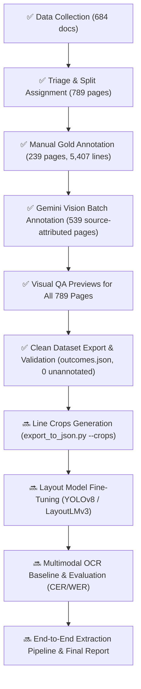

# Nastaliq Document Intelligence — Complete Project Documentation

> **Course Project — Group 2**
> **Stage:** Data Collection, Triage, and Ground-Truth Annotation ✅ Complete
> **Date:** November 2026

---

## 1. Project Goal

Build a pipeline that takes a **scanned / photographed Urdu notice** (written in Nastaliq script) and extracts four structured fields:

| Field | Example |
|---|---|
| Department name | آزاد جموں وکشمیر انٹر میڈیٹ و ثانوی تعلیمی بورڈ میرپور |
| Reference number | 8389-8400 / 2026 |
| Date | 12-11-2026 |
| Subject | پریس ریلیز! |

The pipeline also locates every region on the page (body text, table, stamp, distribution list) so a user can see **where** each value came from.

**Four evaluation metrics** will measure the final pipeline:

| Metric | Measures |
|---|---|
| Layout mAP@0.5 | Did the layout model find the right boxes? |
| Field F1 | Did the pipeline extract the correct text values? |
| OCR CER | Character-level accuracy of the OCR stage |
| OCR WER | Word-level accuracy of the OCR stage |

---

## 2. Data Sources

### 2.1 AJK BISE (Primary Source)
- **Who:** Azad Jammu & Kashmir Board of Intermediate and Secondary Education, Mirpur
- **What:** Notices, press releases, and notifications published on [ajkbise.net](https://ajkbise.net)
- **Downloaded with:** `scripts/download_ajkbise.py` — a custom scraper that walks the AJK BISE website, downloads each document, computes its SHA-256 hash, and writes `data/raw/ajkbise_manifest.csv`
- **Volume:** **672 source files**
- **Years covered:** 2010 – 2026 (bulk: 2016 – 2026)
- **Document types:** Phone-camera photos (WhatsApp, CamScanner), flatbed scans, and a small number of native-digital PDFs

### 2.2 FBR (Secondary / Unseen-Issuer Source)
- **Who:** Federal Board of Revenue, Government of Pakistan
- **What:** 12 official SRO (Statutory Regulatory Order) notifications in Urdu
- **Format:** Clean digital-born PDFs (created in Microsoft Word or similar)
- **Purpose:** Test the pipeline on a **completely different issuer** — different layout, different vocabulary, digital rather than scanned

### 2.3 Totals before deduplication

| Source | Files | Pages after rendering |
|---|---|---|
| AJK BISE | 672 | 759 |
| FBR | 12 | 30 |
| **Combined** | **684** | **789** |

---

## 3. Stage 1 — Data Collection (`download_ajkbise.py`)

```
scripts/download_ajkbise.py
│
├── Scrapes ajkbise.net notification listing pages
├── Downloads each file (JPG, PDF, PNG) with its metadata
├── Computes SHA-256 hash of each file
└── Writes data/raw/ajkbise_manifest.csv
     Columns: file_name, date, title, format, category, source_url, sha256
```

**Output:** `data/raw/ajkbise_manifest.csv` — 672 rows, one per source document, with the original website publish date and title in English.

---

## 4. Stage 2 — Triage & Page Rendering (`triage.py`)

### What it does

Reads every PDF and image in `data/raw/documents/` and:

1. **Renders PDFs to images** at 300 DPI using `pypdfium2`
2. **Classifies capture type** for every page:
   - `photo` — phone camera (detected via EXIF make/model, or filename words: `whatsapp`, `camscanner`, `img_`, etc.)
   - `scan` — flatbed scanner
   - `digital` — PDF with a real Urdu text layer (≥ 50 Urdu Unicode characters extracted by `pypdf`)
3. **Detects near-duplicates** — pages with the same notice saved twice are identified using perceptual hashing (16×16 average hash, Hamming distance ≤ 12) and kept in the same split
4. **Assigns train/val/test splits** at the **document level** (never the page level), so no document straddles two splits:
   - FBR → `test_unseen`
   - AJK newest documents → `test` (~50 pages, type-balanced)
   - AJK next newest → `val` (~30 pages)
   - Older AJK → `train`
5. **Marks pages for annotation** (`annotate=1`): all evaluation pages (test, val, test_unseen) + a type-balanced sample of train pages, up to 250 total
6. **Flags personal data** — file names containing "slip", "result", "noc", "certificate" etc. go into `review_personal_data.csv` for manual checking before annotation

### Output files

| File | Description |
|---|---|
| `data/interim/images/*.png` | 789 rendered page images |
| `data/interim/manifest.csv` | 789 rows — page_id, image path, capture type, year, split, annotate flag |
| `data/interim/review_personal_data.csv` | Files flagged for personal data review |

### Dataset split summary

| Split | Pages | Purpose |
|---|---|---|
| train | 675 | Layout model training, few-shot prompt examples |
| val | 32 | Prompt tuning and threshold calibration |
| test | 52 | **Final evaluation (AJK)** |
| test_unseen | 30 | **Final evaluation (FBR — different issuer)** |

### Capture type breakdown

| Type | Pages | Description |
|---|---|---|
| photo | 409 (52%) | Phone photos — variable angle, lighting, blur |
| scan | 350 (44%) | Flatbed scans — cleaner but older/faded |
| digital | 30 (4%) | FBR PDF text layer — no OCR needed |

---

## 5. Stage 3 — Task Creation (`make_tasks.py`)

Takes the 250 pages marked `annotate=1` from the manifest and builds `tasks.json` for Label Studio.

- **11 pages excluded** — their source files appeared in `review_personal_data.csv` (personal data flag); excluded without `--include-flagged`
- **239 final tasks** created
- **120 pages marked pass2=1** — these get a second annotation pass where every text line is transcribed (for CER/WER measurement)
- Task ordering: test → test_unseen → val → train (evaluation pages done first)

Each task carries:
```json
{
  "page_id": "AJK_0001_p01",
  "split": "train",
  "type": "photo",
  "pass2": 1
}
```

---

## 6. Stage 4 — Manual Annotation (Label Studio)

### Label Studio Setup

**Interface:** `configs/labelstudio_config.xml`
- **9 layout labels** (rectangle boxes): `header_department`, `reference_no`, `date`, `subject`, `body`, `table`, `stamp_signature`, `distribution_list`, `text_line`
- **Per-box textarea** for typing the exact text inside each field box
- **Per-box flags**: `handwritten`, `stamp_over`, `unclear`, `implicit_subject`
- **Page-level flags**: `no_date`, `no_reference_no`, `no_subject`, `contains_personal_data`, `skip_bad_image`

**Guide:** `docs/annotation_guide.md` — step-by-step instructions for annotators

### Annotation Rules

| Box type | Action |
|---|---|
| `header_department` | Box around department header + type the exact Urdu text |
| `date` | Box around date text + type it (e.g. `12-11-2026`) |
| `reference_no` | Box around reference number + type it |
| `subject` | Box around subject/title line + type it; flag `implicit_subject` if inferred |
| `body` | Box only — no text required |
| `table` | Box only |
| `stamp_signature` | Box only |
| `distribution_list` | Box only |
| `text_line` (Pass 2) | Box around every text line + type that exact line in Urdu |

### Gold Annotation Results (`export.json`)

239 manually annotated and verified pages:

```
pages written: 239
warnings: 0

Field presence:
  department    present: 239 / 239  (100%)
  date          present: 195 / 239  (82%)  |  marked absent: 44
  subject       present: 203 / 239  (85%)  |  marked absent: 36
  reference_no  present: 167 / 239  (70%)  |  marked absent: 72

Boxes by label:
  header_department : 239
  subject           : 203
  date              : 195
  reference_no      : 167
  body              : 1,634
  table             : 121
  stamp_signature   : 384
  distribution_list : 159
  text_line         : 5,407  (Pass 2 — line transcriptions)

Box flags:
  implicit_subject     : 203 (all subject boxes — inferred from document type)
  handwritten (ref_no) : 155
  handwritten (date)   : 162
```

**Pass 2 — Line Transcription (CER/WER ground truth):**
- 120 pages have all text lines individually boxed and transcribed
- 5,407 Urdu Nastaliq text line images with verified ground-truth text

---

## 7. Stage 5 — Earlier Automated Labelling Attempt (Surya)

Before the manual annotation phase, the team ran **Surya** (a document layout and OCR model) automatically on the 250 annotated-target pages.

**Notebook:** `auto_label_surya.ipynb`

```
Surya Pipeline:
  1. Layout detection → 6 region types (header, title, body, table, reference, signature)
  2. OCR → text per region and per line
  3. Field extraction → date, department, subject, sro_number via regex + keyword matching
  4. YOLO label export + visual previews
```

**Result:** `nastaliq/auto_labels/auto_annotations.json` — 250 pages with "silver" labels

**Why these were NOT used as the answer key:**
> Surya was not accurate on Nastaliq script. Using a model's output as ground truth without correction means you are measuring how well your model *agrees with another model*, not how well it reads the actual text. CER would look better than it really is.

**What Surya output was used for:**
- YOLO dataset (`nastaliq/auto_labels/yolo_dataset/`) — 683 label files for layout pre-training
- Visual previews for the annotators to use as a reference starting point

---

## 8. Stage 6 — Export & Validation (`export_to_json.py`)

Converts the Label Studio `export.json` into clean per-page JSON files:

```
python export_to_json.py --export export.json --out Dataset --doc-root .
```

**Output:**

| File | Description |
|---|---|
| `data/processed/pages/<page_id>.json` | One clean JSON per page |
| `data/processed/all_pages.jsonl` | One JSON record per page |
| `data/processed/outcomes.json` | All exported page records as a JSON array |
| `data/processed/report.txt` | Validation report |

**Per-page JSON structure:**
```json
{
  "page_id": "AJK_0001_p01",
  "image": "data/interim/images/AJK_0001_p01.png",
  "width": 2108, "height": 3197,
  "source": "AJK", "type": "photo", "split": "train",
  "page_flags": [],
  "fields": {
    "department": {
      "region_id": "reg_1",
      "text": "آزاد جموں وکشمیر انٹر میڈیٹ و ثانوی تعلیمی بورڈ میرپور",
      "bbox": [419.1, 110.0, 1284.0, 95.9],
      "flags": []
    },
    "date": { "text": "12-11-2026", "bbox": [...], "flags": ["handwritten"] },
    "reference_no": { "text": "8389-8400 / 2026", "bbox": [...], "flags": ["handwritten"] },
    "subject": { "text": "پریس ریلیز!", "bbox": [...], "flags": ["implicit_subject"] }
  },
  "regions": [
    { "label": "header_department", "bbox": [...], "text": "آزاد جموں..." },
    { "label": "body",              "bbox": [...], "text": "" },
    { "label": "stamp_signature",   "bbox": [...], "text": "" },
    { "label": "distribution_list", "bbox": [...], "text": "" }
  ]
}
```

---

## 9. Stage 7 — Visual Annotated Previews (`draw_annotations.py`)

Draws coloured bounding boxes on every page image so annotators and reviewers can visually verify the annotations.

**Color scheme:**

| Label | Color |
|---|---|
| `header_department` | 🔵 Blue |
| `reference_no` | 🔴 Red |
| `date` | 🟢 Green |
| `subject` | 🟠 Orange |
| `body` | ⬜ Gray |
| `table` | 🟣 Purple |
| `stamp_signature` | 🩵 Teal |
| `distribution_list` | 🩷 Mauve |
| `text_line` | 💙 Light Blue |

**Output:** `data/previews/` — annotation preview PNGs

---

## 10. Stage 8 — Gemini Vision Annotation Engine (`gemini_batch_annotate.py`)

### 10.1 Background & Need for Vision-Based Annotation
Initially, two approaches were evaluated for the pages assigned to automated annotation:
1. **Surya OCR (`auto_label_surya.ipynb`):** Failed heavily on Nastaliq script — corrupted Urdu character glyphs (replacing Urdu `ی/ک` with Arabic `ي/ك`), merged lines erratically, and misclassified body paragraphs as header dates.
2. **Geometric Ink-Density Heuristics (`auto_annotate_remaining.py`, since removed):** Produced rigid, approximate geometric bands (e.g., top 12% for department) that lacked precise boundaries around skewed or irregular document structures.

To produce a production-grade benchmark, we implemented a custom batch annotation pipeline powered by Google's **Gemini Vision API** (`gemini-3.5-flash-lite` and `gemini-3-flash-preview`).

### 10.2 Architecture & Implementation Features
- **Prompt Engineering for Nastaliq Layout:** Instructs the vision model to detect 9 official classes (`header_department`, `subject`, `date`, `reference_no`, `table`, `body`, `stamp_signature`, `distribution_list`) and output normalized 0–1000 integer coordinates `[ymin, xmin, ymax, xmax]` alongside verbatim Urdu text.
- **Dual-Key Rotation & Quota Management:** Automatically switches between active API keys and falls back to alternate Flash models when 429 rate limits or daily quotas are reached.
- **Resumable Local Caching:** Raw Gemini Vision JSON outputs are cached per page in `data/annotations/gemini_cache/<page_id>.json`. If interrupted, the pipeline skips existing items without consuming redundant API tokens.
- **Label Studio Format Translation:** Maps detected normalized boxes to Label Studio `rectanglelabels` percentages, clamps out-of-bound coordinates, attaches extracted Urdu strings to `textarea` results, and applies default field flags (`implicit_subject`, `handwritten`).
- **Visual Preview Generation:** Concurrently draws color-coded bounding boxes and label tags onto each document image and saves the preview to `data/previews/<page_id>_annotated.png`.

**Output:** The complete set of 789 annotated pages. Current EDA source attribution reports 250 human/Label Studio pages and 539 Gemini Vision pages.

---

## 11. Final Dataset Summary

### Unified Repository Layout

```
Nastaliq-Document-Intelligence/
│
├── .gitignore                          # Generated files and local-only artifacts
├── README.md                           # Main repository readme
├── PROJECT_DOCUMENTATION.md            # Comprehensive project documentation
├── requirements.txt                    # Python environment specifications
├── configs/
│   └── labelstudio_config.xml          # Label Studio interface schema (9 classes + flags)
├── docs/
│   └── annotation_guide.md             # Annotation guide and tagging conventions
├── scripts/
│   ├── paths.py                        # Path constants across the project
│   ├── download_ajkbise.py             # AJK BISE scraper
│   ├── triage.py                       # Rendering, capture classification, splitting
│   ├── make_tasks.py                   # Label Studio task packaging
│   ├── gemini_batch_annotate.py        # Gemini Vision API annotation & preview engine
│   ├── draw_annotations.py             # Visual preview generator
│   └── export_to_json.py               # Validation, evidence linking & export pipeline
├── data/
│   ├── raw/
│   │   ├── documents/
│   │   │   ├── azad Kashmir/           # 672 AJK source files (images & PDFs)
│   │   │   └── FBR/                    # 12 FBR digital Urdu SROs
│   │   ├── ajkbise_manifest.csv        # 672 source metadata records
│   │   └── scrape_failed.csv           # Scrape log
│   ├── interim/
│   │   ├── images/                     # 789 rendered high-res PNG pages
│   │   ├── manifest.csv                # 789 rows with capture types and splits
│   │   └── review_personal_data.csv    # Privacy check log (0 PII leaks)
│   ├── annotations/
│   │   ├── tasks.json                  # 239 Label Studio import tasks
│   │   ├── export.json                 # Complete 789 tasks (Gold + Gemini Vision)
│   │   └── gemini_cache/               # Generated Gemini Vision response cache (ignored)
│   ├── processed/
│   │   ├── pages/                      # 789 per-page structured JSON records
│   │   ├── all_pages.jsonl             # 789 JSON Lines records
│   │   ├── outcomes.json               # 789 records array (outcomes format)
│   │   └── report.txt                  # Official validation report (0 unannotated)
│   ├── previews/                       # 789 visual preview PNGs with color boxes
│   └── eda/                            # EDA summary and 14 charts
└── build/                              # Optional, git-ignored packaging output
```

### Exploratory Data Analysis

The current EDA report is [`data/eda/eda_summary.txt`](data/eda/eda_summary.txt); the folder also contains 14 charts.

| Measure | Result |
|---|---|
| Documents / rendered pages | 684 documents / 789 pages |
| Annotation boxes | 12,475 |
| Source pages | AJK: 759; FBR: 30 |
| Split | Train: 675; validation: 32; test: 52; unseen test: 30 |
| Capture type | Photo: 409; scan: 350; digital: 30 |
| Low-resolution pages | 202 (25.6%) |
| Field presence | Date: 611 (77.4%); department: 737 (93.4%); subject: 693 (87.8%); reference number: 654 (82.9%) |
| Annotation source | Human/Label Studio: 250; Gemini Vision: 539 |
| Files flagged for personal-data review | 44 of 684 (6.4%), based on filenames; not confirmed personal data |

The 239-page figure elsewhere in this document is the verified gold-task count; 250 is the EDA's human/Label Studio source attribution.

Charts: [split](data/eda/01_split_distribution.png), [capture type](data/eda/02_capture_type.png), [low resolution](data/eda/04_low_res.png), [field presence](data/eda/06_field_presence.png), [label distribution](data/eda/08_label_distribution.png), [boxes per page](data/eda/09_boxes_per_page.png), [annotation source](data/eda/13_annotation_source.png), [personal-data review candidates](data/eda/14_personal_data_review.png).

### Verified Dataset Metrics

| Metric | Target | Verified Value |
|---|---|---|
| Total Source Documents | 684 | 684 (672 AJK + 12 FBR) |
| Total Rendered Pages | 789 | 789 |
| Gold Human-Verified Pages | 239 | 239 |
| Gemini Vision Source Pages | 539 | 539 |
| Human/Label Studio Source Pages | 250 | 250 |
| Total Annotated Tasks in `export.json` | 789 | **789 / 789 (100%)** ✅ |
| Total Visual Previews Generated | 789 | **789 (`data/previews/`)** ✅ |
| Pages Not Annotated Yet | 0 | **0** ✅ |
| Personal Data Excluded | 0 | **0** ✅ |
| Total Detected Layout Boxes | — | **12,475 boxes** |
| Total Transcribed Text Lines | — | **5,407 lines** |

### Breakdown of Detected Labels Across All 789 Pages

| Label Class | Box Count | Description / Role |
|---|---|---|
| `header_department` | 744 | Top official issuing authority header |
| `subject` | 703 | Notice subject / title (پریس ریلیز!, نوٹیفکیشن!) |
| `reference_no` | 663 | Dispatch & file reference numbers |
| `date` | 616 | Notification issue dates |
| `body` | 2,380 | Document body paragraphs |
| `table` | 362 | Fee schedules, date sheets, structured grids |
| `stamp_signature` | 898 | Official stamps and signatory designations |
| `distribution_list` | 702 | Bottom dispatch / carbon copy (نقل برائے) lists |
| `text_line` | 5,407 | Individual transcribed text lines |

### Dataset Split Breakdown

| Split | Pages | Split Purpose |
|---|---:|---|
| `train` | 675 | Model training & few-shot fine-tuning |
| `test` | 52 | Final benchmark evaluation |
| `val` | 32 | Hyperparameter tuning & validation |
| `test_unseen` | 30 | Generalization benchmark (FBR unseen issuer) |
| **Total** | **789** | **Complete Dataset** |

---

## 12. What the Ground-Truth Answer Key Enables

| Ground Truth Component | What It Measures | Target Evaluation Metric |
|---|---|---|
| Bounding boxes for all 9 layout classes | Precision of document structure segmentation | **Layout mAP@0.5** |
| 4 key fields (`department`, `ref_no`, `date`, `subject`) | Accuracy of structured information extraction | **Field F1 Score** |
| Evidence linking (`bbox` + `region_id` per field) | Human auditability — verifying the provenance of extracted values | **Extraction Interpretability** |
| Pass-2 line transcription (`lines.tsv`, 5,407 lines) | Raw OCR accuracy on complex Nastaliq calligraphy | **CER (Character Error Rate) & WER** |
| Post-OCR LLM normalization | Error recovery rate of LLM post-processing vs raw OCR | **Delta CER / Normalized CER** |

---

## 13. Project Status & Roadmap



| Pipeline Stage | Status | Notes |
|---|---|---|
| 1. Data Collection | ✅ Complete | 672 AJK BISE notices + 12 FBR SROs (684 documents) |
| 2. Triage & Rendering | ✅ Complete | 789 pages rendered at 300 DPI, capture type classified |
| 3. Gold Annotation | ✅ Complete | 239 pages manually labeled and line-transcribed |
| 4. Gemini Vision Annotation | ✅ Complete | 539 pages attributed to Gemini Vision in the EDA |
| 5. Visual QA Previews | ✅ Complete | 789 color-coded preview overlays in `data/previews/` |
| 6. Validation & Export | ✅ Complete | `export.json`, `outcomes.json`, `all_pages.jsonl`, `report.txt` |
| 7. Line Crops Generation | 🔜 Next Step | `scripts/export_to_json.py --crops` |
| 8. Layout Model Training | 🔜 Planned | YOLO / LayoutLMv3 on 12,475 layout boxes |
| 9. Multimodal OCR Baselines | 🔜 Planned | Line-level CER/WER benchmark |
| 10. Field Extraction & Metrics | 🔜 Planned | Field F1 & Layout mAP evaluation |

---

*Updated: November 2026 — Nastaliq Document Intelligence, Group 2*
