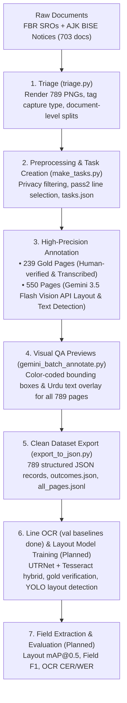

# Nastaliq Document Intelligence

Turn scanned Urdu notices (Nastaliq script) into structured records. For every page, the pipeline extracts
**date, department, subject and reference number**, and links each value to its exact region in the original
image so a human can verify it.

> Course Project, Group 2. Current stage: **Line OCR evaluated on 1,067 human-verified val lines** (UTRNet-Large 15.2% CER, 10.4% on Urdu-only lines; UTRNet + Tesseract hybrid 14.8%). See [Results on human-verified val](#results-on-human-verified-val).

---

## Pipeline Overview



---

## Stages in Detail

| # | Stage | Input | Output | Tool / Status |
|---|---|---|---|---|
| 1 | **Triage & Rendering** | PDFs and images in `data/raw/documents` | `data/interim/images/*.png` (789 pages), `data/interim/manifest.csv` (capture type `digital / scan / photo`, `split`, `annotate`) | `scripts/triage.py` (done) |
| 2 | **Task Creation** | `data/interim/manifest.csv`, `data/interim/review_personal_data.csv` | `data/annotations/tasks.json` (239 evaluation tasks, 120 pass2 line transcription tasks) | `scripts/make_tasks.py` (done) |
| 3 | **Annotation Setup & Guidelines** | `configs/labelstudio_config.xml`, `docs/annotation_guide.md` | Label Studio UI with 9 classes (`header_department`, `reference_no`, `date`, `subject`, `body`, `table`, `stamp_signature`, `distribution_list`, `text_line`), per-box flags, page flags | Label Studio (done) |
| 4 | **Gold Ground-Truth Annotation** | `data/annotations/tasks.json`, page images | 239 ground-truth pages with 5,407 transcribed lines (the line text later proved unreliable: 80% of verified val lines needed correction, see stage 9) | Manual verification (done) |
| 5 | **Gemini Vision Annotation Engine** | Remaining 550 auto-pages, `data/interim/images/` | `data/annotations/gemini_cache/*.json`, high-precision bounding boxes & clean Nastaliq text for all 550 pages | `scripts/gemini_batch_annotate.py` (Gemini 3.5 Flash Lite Vision API, done) |
| 6 | **Visual QA Previews** | `export.json`, original page PNGs | `data/previews/*.png` (789 visual preview images with color-coded boxes and tag labels) | `scripts/gemini_batch_annotate.py` / `draw_annotations.py` (done) |
| 7 | **Dataset Export & Validation** | `data/annotations/export.json` (789 tasks) | `data/processed/pages/*.json` (789 pages), `all_pages.jsonl`, `outcomes.json`, `report.txt` (0 unannotated) | `scripts/export_to_json.py` (done, verified) |
| 8 | **Line OCR** | `data/processed/lines.tsv` + 5,407 line crops | `results/ocr/*.tsv` predictions per line (UTRNet-Large at width 400 / 800, Tesseract, hybrid) | `ocr_utrnet.py`, `ocr_tesseract.py`, `combine_ocr.py`, `postprocess_ocr.py` (val done) |
| 9 | **Line-text verification** | review sheets with crop + gold + prediction | `data/annotations/verified_lines.tsv` (1,067 verified val lines), reviewer agreement, conflicts | `make_review_sheet.py`, `merge_review.py` (val batches b1–b3 done; b4 excluded) |
| 10 | **Field Extraction** | pages + line text | extracted fields (`date`, `department`, `subject`, `reference_no`) | *planned* |
| 11 | **Evaluation** | records + ground truth | CER, WER against verified text (`eval_ocr.py --verified`, done for val), layout mAP@0.5, field F1 | OCR on val done, rest *planned* |

---

## Output Record Format (One per Page)

```json
{
  "page_id": "AJK_0001_p01",
  "file": "azad Kashmir\\0001_541442IMG_0066.jpg",
  "image": "data/interim/images/AJK_0001_p01.png",
  "width": 2108,
  "height": 3197,
  "source": "AJK",
  "type": "photo",
  "split": "train",
  "low_res": 0,
  "page_flags": [],
  "fields": {
    "department": {
      "region_id": "reg_1",
      "text": "آزاد جموں وکشمیر انٹر میڈیٹ و ثانوی تعلیمی بورڈ میرپور",
      "bbox": [419.1, 110.0, 1284.0, 95.9],
      "flags": []
    },
    "reference_no": {
      "region_id": "reg_3",
      "text": "8389-8400 / 2026",
      "bbox": [1380.0, 2009.0, 510.0, 71.9],
      "flags": ["handwritten"]
    },
    "date": {
      "region_id": "reg_4",
      "text": "12-11-2026",
      "bbox": [937.0, 2006.1, 350.0, 68.1],
      "flags": ["handwritten"]
    },
    "subject": {
      "region_id": "reg_2",
      "text": "پریس ریلیز!",
      "bbox": [1621.1, 220.0, 298.1, 117.0],
      "flags": ["implicit_subject"]
    }
  },
  "regions": [ ... ]
}
```

---

## Dataset Splits & Sources

The raw documents are stored in `data/raw/documents/`:

| Folder | Content | Count | Type |
|---|---|---|---|
| `data/raw/documents/azad Kashmir` | Notices & press releases of AJK BISE Mirpur (2010–2026) | 672 files (759 pages) | Scans, phone photos, CamScanner, WhatsApp images |
| `data/raw/documents/FBR` | Official Urdu SROs of the Federal Board of Revenue | 12 files (30 pages) | Clean digital-born PDFs |

### Split Breakdown (Assigned at Document Level)

| Split | Pages | Content | Purpose |
|---|---|---|---|
| `train` | 675 | Older AJK BISE documents | Layout detection and OCR model training |
| `test` | 52 | Newest AJK BISE documents (all capture types represented) | Final benchmark evaluation |
| `val` | 32 | Mid-era AJK BISE documents | Hyperparameter tuning and validation |
| `test_unseen` | 30 | FBR SRO documents | Generalization test on an unseen authority |
| **Total** | **789** | Complete combined dataset | **100% Annotated** |

---

## Annotation Statistics (All 789 Pages)

From official validation report (`data/processed/report.txt`):

- **Total Annotated Pages:** 789 / 789 (100%)
- **Pages Not Annotated Yet:** 0
- **Total Detected Region Boxes:** 11,765 boxes
  - `header_department`: 744 boxes
  - `subject`: 703 boxes
  - `reference_no`: 663 boxes
  - `date`: 616 boxes
  - `table`: 362 boxes
  - `stamp_signature`: 898 boxes
  - `distribution_list`: 702 boxes
  - `body`: 2,380 boxes
  - `text_line`: 5,407 lines

### Visual Preview Color-Coding
All 789 preview images in `data/previews/` follow standardized color coding:
- 🔵 **DEPT** (`header_department`): Blue
- 🔴 **REF#** (`reference_no`): Red
- 🟢 **DATE** (`date`): Green
- 🟠 **SUBJ** (`subject`): Orange
- 🟣 **TABLE** (`table`): Purple
- 🩵 **STAMP** (`stamp_signature`): Teal
- 🩷 **DIST** (`distribution_list`): Mauve
- ⬜ **BODY** (`body`): Gray
- 🟦 **LINE** (`text_line`): Slate Blue

---

## Repository Layout

```
.
├── README.md
├── PROJECT_DOCUMENTATION.md          # Comprehensive technical report
├── requirements.txt                  # Python dependencies
├── configs/
│   └── labelstudio_config.xml        # Label Studio UI (9 classes, per-box & page flags)
├── docs/
│   └── annotation_guide.md           # Team annotation guidelines (Urdu / Roman Urdu)
├── scripts/                          # Pipeline code, run from the repo root
│   ├── paths.py                      # Single source of truth for all data paths
│   ├── download_ajkbise.py           # 0. Scrape AJK BISE notices
│   ├── triage.py                     # 1. Render pages, tag capture type, split by document
│   ├── make_tasks.py                 # 2. manifest -> Label Studio tasks.json
│   ├── gemini_batch_annotate.py      # 3. Gemini Vision API batch annotation & preview engine
│   ├── build_clean_annotations.py    # Clean dictionary & regex Urdu correction rules
│   ├── draw_annotations.py           # Visual QA preview generator
│   ├── export_to_json.py             # 4. Validate export -> clean per-page JSON dataset (+ --crops line crops)
│   ├── ocr_utrnet.py                 # 5. UTRNet-Large line OCR (separate venv; --per-line-seed, --resume)
│   ├── ocr_tesseract.py              # 5. Tesseract 5 line OCR (urd+eng / eng)
│   ├── postprocess_ocr.py            # 5. Fix reversed digit groups in UTRNet date / number lines
│   ├── combine_ocr.py                # 5. Hybrid: Tesseract for lines where UTRNet reads no Urdu
│   ├── eval_ocr.py                   # 6. CER / WER / NED with breakdowns, suspect-reference filter
│   ├── test_eval_ocr.py              # 6. 14 checks of the metrics and rules
│   ├── make_review_sheet.py          # 7. Excel sheets for human verification of line text
│   └── merge_review.py               # 7. Merge reviews -> verified_lines.tsv + reviewer agreement
├── results/ocr/                      # Predictions (*.tsv), run summaries (*.json), reports (*.report.md)
├── third_party/                      # Git-ignored: UTRNet code + weights, Tesseract tessdata
├── data/
│   ├── raw/                          # Immutable source data
│   │   ├── documents/
│   │   │   ├── azad Kashmir/         # 672 AJK BISE notices
│   │   │   └── FBR/                  # 12 FBR Urdu SROs
│   │   ├── ajkbise_manifest.csv      # Source URLs and dates
│   │   └── scrape_failed.csv         # Scraper failure log
│   ├── interim/                      # Triage output
│   │   ├── images/                   # 789 rendered page PNGs
│   │   ├── manifest.csv              # Splits, capture types, resolution
│   │   └── review_personal_data.csv  # Student privacy review list
│   ├── annotations/
│   │   ├── tasks.json                # 239 Label Studio import tasks
│   │   ├── export.json               # 789 tasks (Gold + Gemini Vision)
│   │   ├── export_full.json          # Complete 789-task archive
│   │   ├── verified_lines.tsv        # Human-verified val line text (status, reviewer, provenance)
│   │   ├── review_agreement.json     # Inter-reviewer agreement on double-reviewed lines
│   │   ├── review_conflicts.tsv      # Double-reviewed lines where reviewers disagree
│   │   └── gemini_cache/             # 550 raw Gemini Vision API response caches
│   ├── processed/                    # Clean, model-ready dataset
│   │   ├── pages/                    # 789 per-page JSON records
│   │   ├── all_pages.jsonl           # 789 records, one per line
│   │   ├── outcomes.json             # 789 records as one JSON array
│   │   ├── report.txt                # Validation summary (0 unannotated)
│   │   ├── lines.tsv                 # 5,407 text lines: crop, split, type, region_id, bbox, text
│   │   └── lines/                    # Git-ignored line crops (rebuild with export_to_json.py --crops)
│   ├── review/                       # Reviewed val sheets b1–b3 (.xlsx) + manifest
│   └── previews/                     # 789 annotation overlay PNGs for visual QA
└── build/                            # Git-ignored packaging
```

---

## Setup & Running

```powershell
# 1. Clone & create virtual environment
git clone https://github.com/AleenaAhmed007/Nastaliq-Document-Intelligence.git
cd Nastaliq-Document-Intelligence
python -m venv venv
.\venv\Scripts\Activate.ps1
pip install -r requirements.txt

# 2. Triage raw documents into page images
python scripts/triage.py

# 3. Run Gemini Vision Batch Annotation & Preview Pipeline
$env:GEMINI_API_KEY="your_api_key_here"
python scripts/gemini_batch_annotate.py

# 4. Export & validate final dataset
python scripts/export_to_json.py --export data/annotations/export.json --out data/processed --doc-root .

# 5. Check validation report
Get-Content data/processed/report.txt
```

---

## OCR baseline: UTRNet

[UTRNet](https://github.com/abdur75648/UTRNet-High-Resolution-Urdu-Text-Recognition) (ICDAR 2023, HRNet + DBiLSTM + CTC)
runs in its own venv so its dependencies stay out of the main environment. Code and weights are CC BY-NC-SA 4.0
(non-commercial research use only). `third_party/` and `.venv-utrnet/` are git-ignored.

```powershell
# one-time setup (CPU is enough for inference)
git clone --depth 1 https://github.com/abdur75648/UTRNet-High-Resolution-Urdu-Text-Recognition.git third_party/UTRNet
py -3.13 -m venv .venv-utrnet
.venv-utrnet\Scripts\python -m pip install torch --index-url https://download.pytorch.org/whl/cpu
.venv-utrnet\Scripts\python -m pip install numpy pillow gdown
.venv-utrnet\Scripts\python -m gdown 1xXG7vsSePBw4vtapIEdPWEZ-qrbR9Q9K -O third_party/UTRNet/saved_models/UTRNet-Large/best_norm_ED.pth

# line crops -> data/processed/lines.tsv + lines/*.png
python scripts/export_to_json.py --export data/annotations/export.json --out data/processed --doc-root . --crops

# predict (writes results/ocr/<name>.tsv), then score against the text_line transcriptions
.venv-utrnet\Scripts\python scripts/ocr_utrnet.py --split val --sample 30
python scripts/eval_ocr.py results/ocr/utrnet_large_w400_val_n30.tsv
```

Setup notes: `.venv-utrnet` only works on the machine that created it. Rebuild it on another PC with the commands
above (Python 3.14 + `torch==2.15.0` CPU works too). If the Google Drive download stops part-way, rerun gdown
with `--continue`. The weights file is 189,581,533 bytes. If a crop in `data/processed/lines/` will not open
(seen once: 208 files of random bytes on one disk), rebuild the crops into a temporary folder with
`export_to_json.py --crops --out <tmp>`, check that the readable crops are byte-identical, then copy over only
the broken ones.

**UTRNet's predictions are random.** At test time it averages 5 passes with random "temporal dropout" masks
drawn from `np.random`, one mask per batch. A line's prediction therefore depends on its batch, the run order
and `--resume`. Two width-400 runs agreed on only 10 of 30 lines (differences of 1–2 characters). Comparing
settings line by line, e.g. width 400 vs 800, needs `--per-line-seed`. It runs with batch 1 at the same speed
on CPU and reseeds from the crop name before each line, so a prediction depends only on (crop, seed, width).
Resume, rerun and batch size give identical output (checked 30/30). These runs are written as `..._det.tsv`:

```powershell
.venv-utrnet\Scripts\python scripts/ocr_utrnet.py --split val --imgW 400 --per-line-seed --resume
.venv-utrnet\Scripts\python scripts/ocr_utrnet.py --split val --imgW 800 --per-line-seed --resume
python scripts/eval_ocr.py results/ocr/utrnet_large_w400_val_det.tsv results/ocr/utrnet_large_w800_val_det.tsv --out results/ocr/compare_w400_w800_val_det.report.md
```

### Second OCR system: Tesseract

Tesseract 5 runs on the same crops (`--psm 7`, a single text line) and writes the same TSV format, so
`eval_ocr.py` compares it with UTRNet line for line. It is deterministic. The Urdu and English models come
from `tessdata_best` 4.1.0 and are kept in git-ignored `third_party/tessdata`:

```powershell
winget install UB-Mannheim.TesseractOCR
mkdir third_party\tessdata
curl.exe -L -o third_party/tessdata/urd.traineddata https://github.com/tesseract-ocr/tessdata_best/raw/4.1.0/urd.traineddata
curl.exe -L -o third_party/tessdata/eng.traineddata https://github.com/tesseract-ocr/tessdata_best/raw/4.1.0/eng.traineddata
python scripts/ocr_tesseract.py --split val --lang urd+eng --tessdata third_party/tessdata
python scripts/ocr_tesseract.py --split val --lang eng --tessdata third_party/tessdata
```

The two engines complement each other. UTRNet wins on Urdu, Tesseract `eng` on digits and English.
`combine_ocr.py` sends a line to Tesseract only when UTRNet's own prediction has no Urdu letter (decided from
the predictions, never the gold) and records the choice in a `source` column:

```powershell
python scripts/combine_ocr.py results/ocr/utrnet_large_w400_val_det.tsv results/ocr/tesseract_eng_val.tsv --out results/ocr/hybrid_utrnet_w400_tesseract_eng_val.tsv
```

Ordering caveat: on lines without Urdu, Tesseract writes left-to-right visual order (`-5`), while the review
rules ask for right-to-left reading order (`5-`). Until verified text exists, compare engines on dates and
numbers by digit content, not by where the marks sit.

`eval_ocr.py` reports CER, CER without spaces, WER, NED and exact match, broken down by split, capture type,
line category (`urdu` / `num_latin` / `hw_field`), content and aspect ratio. It also lists the top character confusions and
the worst lines. Any other OCR system can be compared by writing a TSV with `crop` and `pred` columns.

Lines whose reference cannot be a real transcription (Japanese / Chinese characters hallucinated by the
annotation model, or a long row of punctuation given for a full sentence) are left out of scoring and listed
at the end of the report for reviewers to fix. Pass `--keep-suspect` to score them anyway.

UTRNet reads right to left, so on lines with only digits and punctuation it emits a date's digit groups in
reverse (`10-12-2021` comes out as `2021-12-10`). `postprocess_ocr.py` puts them back in logical order,
deciding from the prediction only, and keeps the raw file. It leaves list markers as UTRNet emits them
(`5-` for a printed `-5`), because that is the reading order the review rules ask for:

```powershell
python scripts/postprocess_ocr.py results/ocr/utrnet_large_w400_val.tsv --out results/ocr/utrnet_large_w400_val_pp.tsv
python scripts/eval_ocr.py results/ocr/utrnet_large_w400_val.tsv results/ocr/utrnet_large_w400_val_pp.tsv --out results/ocr/utrnet_large_w400_val_pp.report.md
python scripts/test_eval_ocr.py      # needs only requirements.txt (openpyxl, pillow); not the UTRNet venv
```

On val, postprocessing changes 12 predictions: 9 lines get better and 3 get worse against the original gold
(dates that were already misread), and overall CER is unchanged (23.2%). An earlier version (commit
`b93a362`) also moved list markers to the front (`5-` → `-5`) and seemed to cut digit-only CER from 76% to
62%. Almost all of that came from matching the original gold's marker order, which the review treats as wrong,
so it was withdrawn. Marker order can only be scored fairly against verified text. Postprocessing fixes
output order only, not UTRNet's recognition. Both reports are kept: `utrnet_large_w400_val.report.md` (raw) and `..._pp.report.md`.
The reordering is not always right (the 3 worse lines), and it was only tested on lines with no letters.
Don't extend it to mixed Urdu / English / digit lines without separate evidence.

When reporting, keep three numbers apart: raw UTRNet (the pretrained model as it is), UTRNet + postprocessing
(plus fixed rule-based order corrections), and the `--verified` evaluation (against human-checked text).

### Results before verification (val, preliminary)

These were the first numbers, kept for comparison. They are superseded by
[Results on human-verified val](#results-on-human-verified-val). All 1,437 val lines, scored against the
**original, unverified** line text. 5 lines with a clearly invalid
reference are excluded, so 1,432 lines are scored. Full tables: `results/ocr/compare_engines_val.report.md` and
`results/ocr/compare_w400_w800_val_det.report.md`.

| System | Overall CER | Printed Urdu (960) | Numbers / English (367) |
|---|---|---|---|
| UTRNet-Large, width 400 | 23.2% | 21.6% | 77.8% |
| UTRNet-Large, width 800 | 21.3% | 19.7% | 78.0% |
| Tesseract `urd+eng` | 70.7% | 72.5% | 36.4% |
| Tesseract `eng` | 89.5% | 91.8% | 26.7% |
| **Hybrid: UTRNet w800 + Tesseract `eng`** | **20.4%** | **19.7%** | **45.4%** |

- **Width 800 helps only lines that width 400 squeezes.** On printed Urdu lines with width/height > 25, CER
  falls by 4.6 points (95% CI −5.1 to −4.1, page-level bootstrap; 97 of 102 lines better, 3 worse); for 12.5–25
  it falls by 1.7. Lines that fit in 400 px are unchanged (−0.04, CI includes 0). Both widths were run with
  `--per-line-seed`, so the comparison is on identical lines with identical random masks.
- **The engines complement each other.** UTRNet is far better on Nastaliq; Tesseract `eng` is far better on
  digits and English, where UTRNet often turns Latin text into Urdu-like shapes.
- **Why UTRNet fails on numbers/English lines:** wrong reference text (20% of that category's errors before
  the suspect filter), right-to-left ordering of marks and digit groups, and real misreading of English and
  small printed dates. Digits inside Urdu lines are also only about 53% correct.
- **The reference text is unreliable.** The printed header is misspelled in the gold, 9 lines contain Japanese
  text for Urdu images, and list markers are typed in the wrong order. These numbers are therefore not yet true
  accuracy. The human review comes next.

### Verifying the line gold (do this before reporting CER)

The existing `text_line` transcriptions contain many machine-OCR errors. For example, the fixed printed
header is transcribed as `بورذ`, `میذینث`, `جمول` and `وٹانوی`, and `تشمیر` appears 94 times. CER against them
mixes model errors with gold errors. The original gold and raw predictions are never edited. Verified text is
stored separately:

```powershell
# 1. one Excel file per reviewer (crop image + original gold + UTRNet prediction + columns to fill);
#    80 random lines go to two reviewers each, to measure inter-reviewer agreement
python scripts/make_review_sheet.py --pred results/ocr/utrnet_large_w400_val.tsv --split val --batches 4 --overlap 80
#    -> data/review/val_review_b1.xlsx ... b4.xlsx + val_review_manifest.json (dataset version, file assignment)

# 2. reviewers set status (gold_ok / utrnet_ok / corrected / exclude / illegible), verified_text, reviewer

# 3. collect all sheets (safe to rerun at any time; shows progress per file)
python scripts/merge_review.py
#    -> data/annotations/verified_lines.tsv    final text + status, reviewers, sheet date, lines.tsv version
#    -> data/annotations/review_agreement.json agreement %, keep/drop kappa, inter-reviewer CER
#    -> data/annotations/review_conflicts.tsv  double-reviewed lines where reviewers disagree

# 3b. adjudicate conflicts: a third person fills this sheet; files named *adjudication* override
python scripts/make_review_sheet.py --pred results/ocr/utrnet_large_w400_val.tsv --split val --only data/annotations/review_conflicts.tsv --name val_adjudication --batches 1

# 4. score against verified text only
python scripts/eval_ocr.py results/ocr/utrnet_large_w400_val.tsv --verified data/annotations/verified_lines.tsv
```

With `--verified`, the report has two parts:
- **A review coverage table.** It counts every line of the split as one of: verified (`gold_ok` / `utrnet_ok` /
  `corrected`), excluded, illegible, conflict or unreviewed. Hard lines therefore can't disappear silently.
- **An `original_gold` row next to each OCR system.** This is the original annotation scored against the verified
  text (Evaluation A, annotation error rate). The other rows are OCR error rates (Evaluation B).

All systems are scored on exactly the same lines, and the line count is printed.

Every line in the evaluation set must be reviewed, not only the high-disagreement ones. Verifying only the lines
where UTRNet disagrees with the gold would bias the comparison in UTRNet's favour against the other OCR systems.
Keep `test` and `test_unseen` locked: do not run or inspect models on them until preprocessing, input width and
model choices are final on `val`.

#### Review outcome (val)

| Batch | Lines | Used | Notes |
|---|---|---|---|
| b1, b2 | 372 + 381 | yes | reviewer: toqir dar |
| b3 | 379 | yes | reviewer recorded only as "Reviewer" |
| b4 | 385 | **no** | 316 of 358 "corrected" rows were UTRNet's output copied unchecked (e.g. `۹۹۔` for `11۔`, `(6660)` for `(IBCC)`); kept out of the repo |

Result (`data/annotations/verified_lines.tsv`): **1,067 usable verified lines** (172 `gold_ok`, 74 `utrnet_ok`,
821 `corrected`), 12 excluded / illegible, **15 unresolved conflicts** (not scored) and 343 unreviewed b4 lines.
Of the 38 lines reviewed by two people, 60.5% match exactly and the inter-reviewer CER is 2.3%.

### Results on human-verified val

1,067 human-verified val lines; every system is scored on exactly the same lines. Full report:
[`results/ocr/final_val_verified.report.md`](results/ocr/final_val_verified.report.md).

```powershell
python scripts/eval_ocr.py results/ocr/utrnet_large_w400_val_det.tsv results/ocr/utrnet_large_w800_val_det.tsv results/ocr/tesseract_urd-eng_val.tsv results/ocr/tesseract_eng_val.tsv results/ocr/hybrid_utrnet_w400_tesseract_eng_val.tsv results/ocr/hybrid_utrnet_w800_tesseract_eng_val.tsv --verified data/annotations/verified_lines.tsv --out results/ocr/final_val_verified.report.md
```

| System | CER | WER | Exact lines |
|---|---|---|---|
| UTRNet-Large, width 400 | 17.7% | 64.5% | 13.7% |
| UTRNet-Large, width 800 | 15.2% | 54.5% | 13.6% |
| Tesseract `urd+eng` | 70.6% | 95.6% | 7.8% |
| Tesseract `eng` | 89.9% | 100.0% | 8.0% |
| **Hybrid: UTRNet w800 + Tesseract `eng`** | **14.8%** | **54.1%** | **17.4%** |
| *Original gold (annotation error rate)* | *16.2%* | *52.4%* | *19.6%* |

CER by line content:

| Content | Lines | UTRNet w800 | Hybrid w800 | Tesseract `eng` | Original gold |
|---|---|---|---|---|---|
| Urdu only | 430 | **10.4%** | 10.4% | 93.7% | 15.6% |
| Urdu + digits | 267 | 14.7% | 14.5% | 90.1% | 17.2% |
| Urdu + English | 100 | 19.7% | 19.7% | 88.9% | 15.2% |
| Digits only | 218 | 59.9% | 40.0% | **37.5%** | 30.6% |
| English only | 51 | 80.6% | 70.1% | **22.9%** | 2.5% |

UTRNet-Large CER by line width/height (all verified lines):

| Width / height | Lines | Width 400 | Width 800 |
|---|---|---|---|
| ≤ 12.5 (fits 400 px) | 712 | 21.6% | 21.4% |
| 12.5–25 | 276 | 16.2% | 13.7% |
| > 25 | 79 | 16.3% | **10.9%** |

Findings:
- **The original line annotation was unreliable.** Reviewers changed the text of 858 of 1,067 lines (80%); the
  original gold has 16.2% CER against the verified text and is exactly right on only 19.6% of lines.
- **UTRNet-Large reads printed Nastaliq well:** 10.4% CER on Urdu-only lines and 15.2% overall at width 800.
  Measured against the unverified gold, the same model seemed to have 21.3%; most of the difference was gold error.
- **Width 800 is the better setting.** It removes the squeezing of long lines (16.3% → 10.9% on lines wider than
  25:1) and leaves lines that fit in 400 px unchanged.
- **Digits and English need Tesseract.** UTRNet scores 60–81% CER on digit-only and English-only lines, Tesseract
  `eng` 23–38%. The hybrid is therefore the best system (14.8%). Its routing still sends most English-only lines
  to UTRNet (70.1% vs 22.9% for Tesseract alone), so routing is the next improvement.
- **Photos vs scans:** almost no difference (UTRNet w800 14.8% on 711 photo lines, 16.1% on 356 scan lines).

Limitations:
- 343 val lines (batch b4) are unverified and 15 conflicts are unresolved; neither is scored.
- Inter-reviewer agreement rests on only 38 double-reviewed lines.
- Reviewers saw UTRNet's (width 400) output while reviewing, so UTRNet's scores may be slightly optimistic;
  Tesseract had no such advantage.
- These are val results. `test` and `test_unseen` have not been run, and their line text is not yet verified.

---

## Status

- [x] Data collection (FBR Urdu SROs, AJK BISE notices)
- [x] Triage and document-level split (789 pages)
- [x] Label Studio XML configuration and team annotation guidelines
- [x] Ground-truth manual annotation of 239 evaluation pages (5,407 lines)
- [x] High-precision Gemini Vision API layout detection for remaining 550 pages
- [x] Visual QA preview rendering for all 789 pages (`data/previews/`)
- [x] Export to clean structured dataset (`data/processed/pages/`, `data/processed/all_pages.jsonl`, `outcomes.json`) with 0 unannotated pages
- [x] Line crops generation (`scripts/export_to_json.py --crops`, 5,407 crops)
- [x] UTRNet-Large baseline on all val lines at width 400 and 800, deterministic (`--per-line-seed`)
- [x] OCR evaluation with breakdowns, suspect-reference filter and 14 metric checks (`eval_ocr.py`, `test_eval_ocr.py`)
- [x] Tesseract 5 baseline and UTRNet + Tesseract hybrid (`ocr_tesseract.py`, `combine_ocr.py`)
- [x] Review sheets for human verification of val line text (`data/review/`, 80 lines double-reviewed)
- [x] Human review of val line text: 1,067 verified lines (b1–b3), agreement on 38 double-reviewed lines; b4 excluded
- [x] Evaluation against verified text (`results/ocr/final_val_verified.report.md`): width 800 and the hybrid confirmed
- [ ] Resolve the 15 review conflicts (adjudication sheet) and re-review batch b4 (343 lines)
- [ ] Fix hybrid routing so English-only lines go to Tesseract (tuned on val), then freeze the configuration
- [ ] Single run of the frozen configuration on `test` / `test_unseen`, after verifying their line text
- [ ] Layout model training (YOLO / multimodal models)
- [ ] Field extraction and normalization rules
- [ ] Final evaluation (verified CER/WER, Layout mAP@0.5, Field F1)

---

## Team

- Aleena Ahmed
- Seerat Fatima
- Muhammad Adil
- Muhammad Omer
