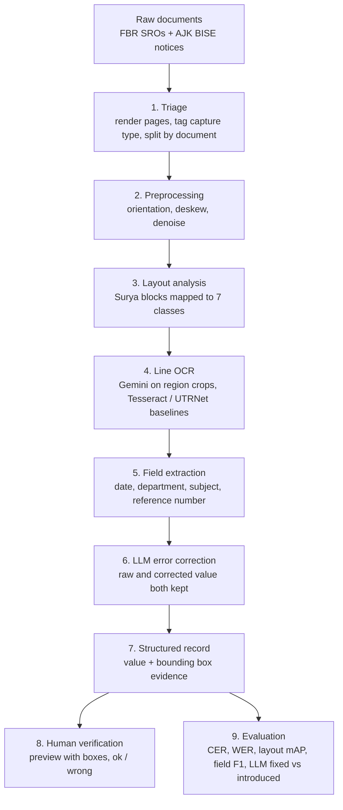

# Nastaliq Document Intelligence

Turn scanned Urdu notices (Nastaliq script) into structured records. For every page the pipeline extracts
**date, department, subject and reference number**, and links each value to its region in the original
image so a human can verify it.

> Course project, Group 2. Status: work in progress (see [Status](#status)). Stages marked *planned* are not implemented yet.

## Pipeline overview



## Stages in detail

| # | Stage | Input | Output | Tool / status |
|---|---|---|---|---|
| 1 | **Triage** | PDFs and images in `Dataset/DOCS-PDFS` | `pages/images/*.png`, `pages/manifest.csv` (capture type `digital / scan / photo`, `low_res`, `year`, `split`, `annotate`) | `triage.py` (done) |
| 2 | **Preprocessing** | page image | corrected image (EXIF rotation done in triage; deskew and denoise optional) | *planned* |
| 3 | **Layout analysis** | page image | blocks with class `header, title, body, table, reference, signature, stamp` and a box each | Surya in `auto_label_surya.ipynb`; optional YOLO layout model trained on corrected labels |
| 4 | **Line OCR** | line / region crops from stage 3 | text per line with an exact pixel box | Gemini (`gemini-3.5-flash`) via `gemini_ocr.py`; baselines Tesseract (`urd`) and UTRNet |
| 5 | **Field extraction** | layout blocks + OCR lines | `date`, `department`, `subject`, `reference_number`, each with source line(s) and box | rules, keywords and position; *planned* |
| 6 | **LLM error correction** | raw OCR text of lines and fields | corrected text; the raw text is never overwritten | LLM post-correction; *planned* |
| 7 | **Structured record** | stages 3-6 | one JSON per page (see below) | *planned* |
| 8 | **Human verification** | record + page image | preview image with boxes, `review.csv` with status `ok / wrong` | notebook previews; Label Studio for corrections |
| 9 | **Evaluation** | records + ground truth | metrics table, per capture type | *planned* |

Design choices:
- **Every value keeps its evidence.** OCR runs on crops, so each text has an exact box that comes from our own layout step, not from a guessed coordinate.
- **Raw and corrected text are both stored**, so the effect of the LLM can be measured.
- **Splits are by document**, never by page, and near-duplicate documents stay together.

## Output record (one per page)

```json
{
  "page_id": "<page id>",
  "doc_id": "<document id>",
  "source": "AJK",
  "capture_type": "photo",
  "fields": {
    "date": {
      "text_raw": "<OCR text>",
      "text_corrected": "<text after LLM correction>",
      "value": "<normalised value, e.g. ISO date>",
      "bbox": [0, 0, 0, 0],
      "line_ids": [0],
      "ocr_engine": "gemini-3.5-flash",
      "found_by": "rule",
      "llm_changed": true,
      "review_status": "pending"
    },
    "department": {},
    "subject": {},
    "reference_number": {}
  },
  "layout": [{"label": "header", "bbox": [0, 0, 0, 0]}],
  "lines": [{"id": 0, "text": "<line text>", "bbox": [0, 0, 0, 0]}]
}
```
Values above are placeholders. `bbox` is `[x_min, y_min, x_max, y_max]` in image pixels.

## Data

The raw documents are stored in `Dataset/DOCS-PDFS/` (private repository).

| Folder | Content | Type |
|---|---|---|
| `Dataset/DOCS-PDFS/FBR` | 12 Urdu SRO notifications of the Federal Board of Revenue | digital-born PDFs, clean |
| `Dataset/DOCS-PDFS/azad Kashmir` | 672 notices / press releases of the AJK Board of Intermediate and Secondary Education (2016-2026) | real scans, phone photos, CamScanner and WhatsApp images |

`Dataset/ajkbise_manifest.csv` lists the source URL and website date of every AJK file.

Splits (set by `triage.py`):

| Split | Content | Use |
|---|---|---|
| `train` | older AJK documents | layout model training, few-shot examples |
| `val` | next newest AJK documents | tuning prompts and rules |
| `test` | newest AJK documents, every capture type represented | final scores (manually corrected pages only) |
| `test_unseen` | FBR documents | unseen-issuer test |

Rules we follow:
- public documents only, source URL recorded for every file
- no private identity documents; files that may list candidate names or roll numbers are held back and reviewed
- test pages are never used to tune prompts or rules

Not included: the UROCR text-line dataset (download it from its original source).

## Repository layout

```
.
├── README.md
├── requirements.txt
├── Dataset/
│   ├── DOCS-PDFS/            raw documents (FBR, azad Kashmir)
│   └── ajkbise_manifest.csv  source URLs and dates
├── pages/                    triage output: manifest.csv and page images
├── download_ajkbise.py       collect the AJK BISE notices
├── triage.py                 render pages, tag capture type, split by document
├── auto_label_surya.ipynb    Surya layout + OCR pre-labelling (Colab T4)
└── gemini_ocr.py             OCR with Gemini
```

## Setup

```powershell
python -m venv venv
.\venv\Scripts\Activate.ps1
pip install -r requirements.txt
```

For Gemini OCR set an API key (never commit it):

```powershell
$env:GEMINI_API_KEY="your_key"
```

## How to run

1. Triage: `python triage.py --input Dataset/DOCS-PDFS --out pages`
2. Pre-label layout with Surya (`auto_label_surya.ipynb`), then correct the test pages in Label Studio
3. OCR: `python gemini_ocr.py --pages pages/manifest.csv --split test --out gemini_out`
4. Field extraction, LLM correction and evaluation: *planned scripts*

## Annotation guide (short)

| Field | Meaning |
|---|---|
| `date` | date printed or written on the notice (not the website upload date) |
| `department` | issuing office (FBR: Revenue Division; AJK: Board / Controller of Examinations) |
| `subject` | subject of the notice as written on the page |
| `reference_number` | FBR: SRO number; AJK: outward number (often handwritten); `null` if absent |

Layout classes: header, title, body, table, reference, signature, stamp. Handwritten parts get a flag.

For the test pages we also transcribe the text lines by hand (needed for CER / WER). OCR output is never used as ground truth.

## Evaluation protocol

| Metric | Computed on | How |
|---|---|---|
| **CER, WER** | manually transcribed test lines | `jiwer`; same normalisation for every engine (digits, spaces, zero-width characters) |
| **Layout mAP** | manually corrected test pages | mAP@0.5 and mAP@0.5:0.95 over the 7 classes |
| **Field F1** | first page of every test document | exact match after normalising dates and numbers; per field and averaged |
| **LLM fixed / introduced** | same test lines and fields | align words with ground truth: *fixed* = wrong before and right after, *introduced* = right before and wrong after |
| **Robustness (stretch)** | test pages grouped by `capture_type` and `low_res` | clean vs low-resolution vs phone-camera photos |

Engines compared for OCR: Gemini, Tesseract, optionally UTRNet. Scores are reported only on manually corrected test pages, never on automatic labels, and separately for AJK `test` and FBR `test_unseen`.

## Status

- [x] Data collection (FBR Urdu SROs, AJK BISE notices)
- [x] Triage and document-level split
- [ ] Surya pre-labelling
- [ ] Annotation of test / validation pages
- [ ] Baseline OCR (Tesseract)
- [ ] Gemini OCR
- [ ] Layout model
- [ ] Field extraction
- [ ] LLM error correction
- [ ] Structured records and human verification view
- [ ] Final evaluation and report

## Team

- Aleena Ahmed
- Seerat Fatima
- Muhammad Adil
- Muhammad Omer 

## Notes and licences

- Source documents belong to their issuers.
- Pre-trained models keep their own licences (for example UTRNet is CC BY-NC 4.0, non-commercial).
