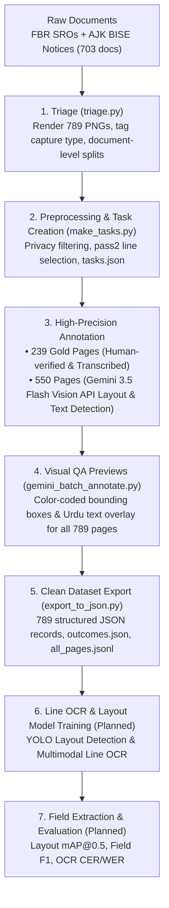

# Nastaliq Document Intelligence

Turn scanned Urdu notices (Nastaliq script) into structured records. For every page, the pipeline extracts
**date, department, subject and reference number**, and links each value to its exact region in the original
image so a human can verify it.

> Course Project, Group 2. Current stage: **Data Collection, Triage, and Complete 789-Page Annotation Pipeline (Gold + Gemini Vision API)**.

---

## Pipeline Overview



---

## Stages in Detail

| # | Stage | Input | Output | Tool / Status |
|---|---|---|---|---|
| 1 | **Triage & Rendering** | PDFs and images in `data/raw/documents` | `data/interim/images/*.png` (789 pages), `data/interim/manifest.csv` (capture type `digital / scan / photo`, `split`, `annotate`) | `scripts/triage.py` (done) |
| 2 | **Task Creation** | `data/interim/manifest.csv`, `data/interim/review_personal_data.csv` | `data/annotations/tasks.json` (239 evaluation tasks, 120 pass2 line transcription tasks) | `scripts/make_tasks.py` (done) |
| 3 | **Annotation Setup & Guidelines** | `configs/labelstudio_config.xml`, `docs/annotation_guide.md` | Label Studio UI with 9 classes (`header_department`, `reference_no`, `date`, `subject`, `body`, `table`, `stamp_signature`, `distribution_list`, `text_line`), per-box flags, page flags | Label Studio (done) |
| 4 | **Gold Ground-Truth Annotation** | `data/annotations/tasks.json`, page images | 239 human-verified ground-truth pages with 5,407 transcribed lines | Manual verification (done) |
| 5 | **Gemini Vision Annotation Engine** | Remaining 550 auto-pages, `data/interim/images/` | `data/annotations/gemini_cache/*.json`, high-precision bounding boxes & clean Nastaliq text for all 550 pages | `scripts/gemini_batch_annotate.py` (Gemini 3.5 Flash Lite Vision API, done) |
| 6 | **Visual QA Previews** | `export.json`, original page PNGs | `data/previews/*.png` (789 visual preview images with color-coded boxes and tag labels) | `scripts/gemini_batch_annotate.py` / `draw_annotations.py` (done) |
| 7 | **Dataset Export & Validation** | `data/annotations/export.json` (789 tasks) | `data/processed/pages/*.json` (789 pages), `all_pages.jsonl`, `outcomes.json`, `report.txt` (0 unannotated) | `scripts/export_to_json.py` (done, verified) |
| 8 | **Line OCR & Field Extraction** | crops and pages from stage 7 | Text per line, extracted fields (`date`, `department`, `subject`, `reference_no`) | *planned* |
| 9 | **Evaluation** | records + ground truth (`lines.tsv`) | CER, WER, layout mAP@0.5, field F1 | *planned* |

---

## Output Record Format (One per Page)

```json
{
  "page_id": "AJK_0001_p01",
  "file": "azad Kashmir\\0001_541442IMG_0066.jpg",
  "image": "data/interim/images/AJK_0001_p01.png",
  "width": 2108,
  "height": 3197,
  "source": "AJK",
  "type": "photo",
  "split": "train",
  "low_res": 0,
  "page_flags": [],
  "fields": {
    "department": {
      "region_id": "reg_1",
      "text": "آزاد جموں وکشمیر انٹر میڈیٹ و ثانوی تعلیمی بورڈ میرپور",
      "bbox": [419.1, 110.0, 1284.0, 95.9],
      "flags": []
    },
    "reference_no": {
      "region_id": "reg_3",
      "text": "8389-8400 / 2026",
      "bbox": [1380.0, 2009.0, 510.0, 71.9],
      "flags": ["handwritten"]
    },
    "date": {
      "region_id": "reg_4",
      "text": "12-11-2026",
      "bbox": [937.0, 2006.1, 350.0, 68.1],
      "flags": ["handwritten"]
    },
    "subject": {
      "region_id": "reg_2",
      "text": "پریس ریلیز!",
      "bbox": [1621.1, 220.0, 298.1, 117.0],
      "flags": ["implicit_subject"]
    }
  },
  "regions": [ ... ]
}
```

---

## Dataset Splits & Sources

The raw documents are stored in `data/raw/documents/`:

| Folder | Content | Count | Type |
|---|---|---|---|
| `data/raw/documents/azad Kashmir` | Notices & press releases of AJK BISE Mirpur (2010–2026) | 672 files (759 pages) | Scans, phone photos, CamScanner, WhatsApp images |
| `data/raw/documents/FBR` | Official Urdu SROs of the Federal Board of Revenue | 12 files (30 pages) | Clean digital-born PDFs |

### Split Breakdown (Assigned at Document Level)

| Split | Pages | Content | Purpose |
|---|---|---|---|
| `train` | 675 | Older AJK BISE documents | Layout detection and OCR model training |
| `test` | 52 | Newest AJK BISE documents (all capture types represented) | Final benchmark evaluation |
| `val` | 32 | Mid-era AJK BISE documents | Hyperparameter tuning and validation |
| `test_unseen` | 30 | FBR SRO documents | Generalization test on an unseen authority |
| **Total** | **789** | Complete combined dataset | **100% Annotated** |

---

## Annotation Statistics (All 789 Pages)

From official validation report (`data/processed/report.txt`):

- **Total Annotated Pages:** 789 / 789 (100%)
- **Pages Not Annotated Yet:** 0
- **Total Detected Region Boxes:** 11,765 boxes
  - `header_department`: 744 boxes
  - `subject`: 703 boxes
  - `reference_no`: 663 boxes
  - `date`: 616 boxes
  - `table`: 362 boxes
  - `stamp_signature`: 898 boxes
  - `distribution_list`: 702 boxes
  - `body`: 2,380 boxes
  - `text_line`: 5,407 lines

### Visual Preview Color-Coding
All 789 preview images in `data/previews/` follow standardized color coding:
- 🔵 **DEPT** (`header_department`): Blue
- 🔴 **REF#** (`reference_no`): Red
- 🟢 **DATE** (`date`): Green
- 🟠 **SUBJ** (`subject`): Orange
- 🟣 **TABLE** (`table`): Purple
- 🩵 **STAMP** (`stamp_signature`): Teal
- 🩷 **DIST** (`distribution_list`): Mauve
- ⬜ **BODY** (`body`): Gray
- 🟦 **LINE** (`text_line`): Slate Blue

---

## Repository Layout

```
.
├── .gitignore
├── README.md
├── PROJECT_DOCUMENTATION.md          # Comprehensive technical report
├── requirements.txt                  # Python dependencies
├── configs/
│   └── labelstudio_config.xml        # Label Studio UI (9 classes, per-box & page flags)
├── docs/
│   └── annotation_guide.md           # Team annotation guidelines (Urdu / Roman Urdu)
├── scripts/                          # Pipeline code, run from the repo root
│   ├── paths.py                      # Single source of truth for all data paths
│   ├── download_ajkbise.py           # 0. Scrape AJK BISE notices
│   ├── triage.py                     # 1. Render pages, tag capture type, split by document
│   ├── make_tasks.py                 # 2. manifest -> Label Studio tasks.json
│   ├── gemini_batch_annotate.py      # 3. Gemini Vision API batch annotation & preview engine
│   ├── draw_annotations.py           # Visual QA preview generator
│   └── export_to_json.py             # 4. Validate export -> clean per-page JSON dataset
├── data/
│   ├── raw/                          # Immutable source data
│   │   ├── documents/
│   │   │   ├── azad Kashmir/         # 672 AJK BISE notices
│   │   │   └── FBR/                  # 12 FBR Urdu SROs
│   │   ├── ajkbise_manifest.csv      # Source URLs and dates
│   │   └── scrape_failed.csv         # Scraper failure log
│   ├── interim/                      # Triage output
│   │   ├── images/                   # 789 rendered page PNGs
│   │   ├── manifest.csv              # Splits, capture types, resolution
│   │   └── review_personal_data.csv  # Student privacy review list
│   ├── annotations/
│   │   ├── tasks.json                # 239 Label Studio import tasks
│   │   ├── export.json               # 789 tasks (Gold + Gemini Vision)
│   │   └── gemini_cache/             # Generated Gemini Vision response cache (ignored)
│   ├── processed/                    # Clean, model-ready dataset
│   │   ├── pages/                    # 789 per-page JSON records
│   │   ├── all_pages.jsonl           # 789 records, one per line
│   │   ├── outcomes.json             # 789 records as one JSON array
│   │   └── report.txt                # Validation summary (0 unannotated)
│   └── previews/                     # 789 annotation overlay PNGs for visual QA
└── build/                            # Optional, git-ignored packaging output
```

---

## Setup & Running

```powershell
# 1. Clone & create virtual environment
git clone https://github.com/AleenaAhmed007/Nastaliq-Document-Intelligence.git
cd Nastaliq-Document-Intelligence
python -m venv venv
.\venv\Scripts\Activate.ps1
pip install -r requirements.txt

# 2. Triage raw documents into page images
python scripts/triage.py

# 3. Run Gemini Vision Batch Annotation & Preview Pipeline
$env:GEMINI_API_KEY="your_api_key_here"
python scripts/gemini_batch_annotate.py

# 4. Export & validate final dataset
python scripts/export_to_json.py --export data/annotations/export.json --out data/processed --doc-root .

# 5. Check validation report
Get-Content data/processed/report.txt
```

---

## Status

- [x] Data collection (FBR Urdu SROs, AJK BISE notices)
- [x] Triage and document-level split (789 pages)
- [x] Label Studio XML configuration and team annotation guidelines
- [x] Ground-truth manual annotation of 239 evaluation pages (5,407 lines)
- [x] High-precision Gemini Vision API layout detection for remaining 550 pages
- [x] Visual QA preview rendering for all 789 pages (`data/previews/`)
- [x] Export to clean structured dataset (`data/processed/pages/`, `data/processed/all_pages.jsonl`, `outcomes.json`) with 0 unannotated pages
- [ ] Line crops generation (`scripts/export_to_json.py --crops`)
- [ ] Baseline OCR & Layout model training (YOLO / Multimodal models)
- [ ] Field extraction and normalization rules
- [ ] Final evaluation (CER, WER, Layout mAP@0.5, Field F1)

---

## Team

- Aleena Ahmed
- Seerat Fatima
- Muhammad Adil
- Muhammad Omer
