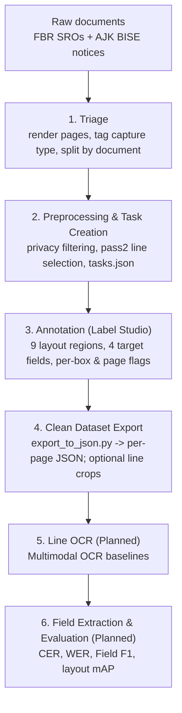

# Nastaliq Document Intelligence

Turn scanned Urdu notices (Nastaliq script) into structured records. For every page the pipeline extracts
**date, department, subject and reference number**, and links each value to its region in the original
image so a human can verify it.

> Course project, Group 2. Current stage: **Data Collection, Triage, and Complete Ground-Truth Annotation**.

## Pipeline overview



## Stages in detail

| # | Stage | Input | Output | Tool / status |
|---|---|---|---|---|
| 1 | **Triage** | PDFs and images in `data/raw/documents` | `data/interim/images/*.png`, `data/interim/manifest.csv` (capture type `digital / scan / photo`, `low_res`, `year`, `split`, `annotate`) | `scripts/triage.py` (done) |
| 2 | **Task Creation** | `data/interim/manifest.csv`, `data/interim/review_personal_data.csv` | `data/annotations/tasks.json` (239 tasks: test, test_unseen, val, train; 120 pass2 line transcription tasks) | `scripts/make_tasks.py` (done) |
| 3 | **Annotation Setup & Guidelines** | `configs/labelstudio_config.xml`, `docs/annotation_guide.md` | Label Studio UI with 9 classes (`header_department`, `reference_no`, `date`, `subject`, `body`, `table`, `stamp_signature`, `distribution_list`, `text_line`), per-box flags, page flags | Label Studio (done) |
| 4 | **Ground-Truth Annotation** | `data/annotations/tasks.json`, page images | `data/annotations/export.json` (239 annotated tasks, verified coordinates and clean Nastaliq text) | Verified annotations (done) |
| 5 | **Dataset Export & Validation** | `data/annotations/export.json` | `data/processed/pages/*.json`, `all_pages.jsonl`, `report.txt`; line crops and `lines.tsv` are optional (`--crops`) | `scripts/export_to_json.py` (done, 0 warnings) |
| 6 | **Line OCR & Field Extraction** | crops and pages from stage 5 | Text per line, extracted fields (`date`, `department`, `subject`, `reference_no`) | *planned* |
| 7 | **Evaluation** | records + ground truth (`lines.tsv`) | CER, WER, layout mAP, field F1 | *planned* |

---

## Output record (one per page)

```json
{
  "page_id": "AJK_0001_p01",
  "file": "azad Kashmir\\0001_541442IMG_0066.jpg",
  "image": "data/interim/images/AJK_0001_p01.png",
  "width": 2108,
  "height": 3197,
  "source": "AJK",
  "type": "photo",
  "split": "train",
  "low_res": 0,
  "page_flags": [],
  "fields": {
    "department": {
      "region_id": "reg_1",
      "text": "آزاد جموں وکشمیر انٹر میڈیٹ و ثانوی تعلیمی بورڈ میرپور",
      "bbox": [419.1, 110.0, 1284.0, 95.9],
      "flags": []
    },
    "reference_no": {
      "region_id": "reg_3",
      "text": "8389-8400 / 2026",
      "bbox": [1380.0, 2009.0, 510.0, 71.9],
      "flags": ["handwritten"]
    },
    "date": {
      "region_id": "reg_4",
      "text": "12-11-2026",
      "bbox": [937.0, 2006.1, 350.0, 68.1],
      "flags": ["handwritten"]
    },
    "subject": {
      "region_id": "reg_2",
      "text": "پریس ریلیز!",
      "bbox": [1621.1, 220.0, 298.1, 117.0],
      "flags": ["implicit_subject"]
    }
  },
  "regions": [ ... ]
}
```

---

## Data

The raw documents are stored in `data/raw/documents/`:

| Folder | Content | Type |
|---|---|---|
| `data/raw/documents/FBR` | 12 Urdu SRO notifications of the Federal Board of Revenue | digital-born PDFs, clean |
| `data/raw/documents/azad Kashmir` | 672 notices / press releases of the AJK Board of Intermediate and Secondary Education (2016-2026) | real scans, phone photos, CamScanner and WhatsApp images |

`data/raw/ajkbise_manifest.csv` lists the source URL and website date of every AJK file.

Splits (set by `triage.py`):

| Split | Content | Use |
|---|---|---|
| `train` | older AJK documents (129 pages) | layout model training, few-shot examples |
| `val` | next newest AJK documents (31 pages) | tuning prompts and rules |
| `test` | newest AJK documents, every capture type represented (49 pages) | final scores (manually verified pages) |
| `test_unseen` | FBR documents (30 pages) | unseen-issuer test |

---

## Repository layout

```
.
├── README.md
├── requirements.txt
├── configs/
│   └── labelstudio_config.xml        # Label Studio UI (9 classes, per-box & page flags)
├── docs/
│   └── annotation_guide.md           # Team annotation guidelines (Urdu / Roman Urdu)
├── scripts/                          # Pipeline code, run from the repo root
│   ├── paths.py                      # Single source of truth for all data paths
│   ├── download_ajkbise.py           # 0. Scrape AJK BISE notices
│   ├── triage.py                     # 1. Render pages, tag capture type, split by document
│   ├── make_tasks.py                 # 2. manifest -> Label Studio tasks.json
│   ├── auto_annotate_remaining.py    # 3b. Heuristic labels for the 550 un-annotated pages
│   ├── draw_annotations.py           # QA: draw boxes onto page images
│   └── export_to_json.py             # 4. Validate export -> clean per-page dataset
├── data/
│   ├── raw/                          # Immutable source data (never edit)
│   │   ├── documents/
│   │   │   ├── azad Kashmir/         # 672 AJK BISE notices
│   │   │   └── FBR/                  # 12 FBR Urdu SROs
│   │   ├── ajkbise_manifest.csv      # Source URLs and dates
│   │   └── scrape_failed.csv         # Scraper failure log
│   ├── interim/                      # Triage output
│   │   ├── images/                   # 789 rendered page PNGs
│   │   ├── manifest.csv              # Splits, capture types, resolution
│   │   └── review_personal_data.csv  # Student privacy review list
│   ├── annotations/
│   │   ├── tasks.json                # 239 Label Studio import tasks
│   │   ├── export.json               # Gold: 239 human-verified pages
│   │   ├── export_full.json          # Gold + auto-heuristic (789 pages)
│   │   └── auto/                     # Heuristic annotation inputs/outputs
│   │       ├── remaining_pages.json
│   │       └── remaining_annotations.json
│   ├── processed/                    # Clean, model-ready dataset
│   │   ├── pages/                    # 239 per-page JSON records
│   │   ├── all_pages.jsonl           # Gold records, one per line
│   │   ├── all_pages_full.jsonl      # Gold + auto records (789)
│   │   ├── outcomes.json             # All 239 gold records as one JSON array
│   │   └── report.txt                # Validation summary (0 warnings)
│   └── previews/                     # 789 annotation overlay PNGs for visual QA
└── build/                            # Git-ignored packaging (annotate_upload.zip)
```

Image paths stored inside the data files (e.g. `"image": "data/interim/images/AJK_0001_p01.png"`) are
relative to the repo root; the `file` field is relative to `data/raw/documents/`.

---

## Setup

```powershell
python -m venv venv
.\venv\Scripts\Activate.ps1
pip install -r requirements.txt
```

---

## How to run

All commands run from the repo root; defaults come from `scripts/paths.py`.

1. **Triage:**
   ```powershell
   python scripts/triage.py            # data/raw/documents -> data/interim
   ```
2. **Build Label Studio tasks:**
   ```powershell
   python scripts/make_tasks.py        # -> data/annotations/tasks.json
   ```
   Start Label Studio with `LABEL_STUDIO_LOCAL_FILES_DOCUMENT_ROOT` set to the repo root and import
   `configs/labelstudio_config.xml` as the labeling config.
3. **Auto-annotate remaining pages (optional):**
   ```powershell
   python scripts/auto_annotate_remaining.py
   ```
4. **Export & validate dataset:**
   ```powershell
   python scripts/export_to_json.py    # data/annotations/export.json -> data/processed
   ```
   Check `data/processed/report.txt` for field presence and warnings. Add `--crops` to generate
   `data/processed/lines/` and `lines.tsv` for OCR training.
5. **Visual QA previews:**
   ```powershell
   python scripts/draw_annotations.py  # -> data/previews
   ```

---

## Status

- [x] Data collection (FBR Urdu SROs, AJK BISE notices)
- [x] Triage and document-level split
- [x] Label Studio XML configuration and team annotation guidelines
- [x] Ground-truth annotation of 239 pages (5,407 transcribed lines)
- [x] Export to clean structured dataset (`data/processed/pages/`, `data/processed/all_pages.jsonl`) with 0 warnings
- [ ] Generate line crops and `data/processed/lines.tsv` (`scripts/export_to_json.py --crops`)
- [ ] Baseline OCR (Tesseract / Multimodal models)
- [ ] Field extraction and normalization rules
- [ ] Evaluation (CER, WER, Layout mAP, Field F1)

---

## Team

- Aleena Ahmed
- Seerat Fatima
- Muhammad Adil
- Muhammad Omer
