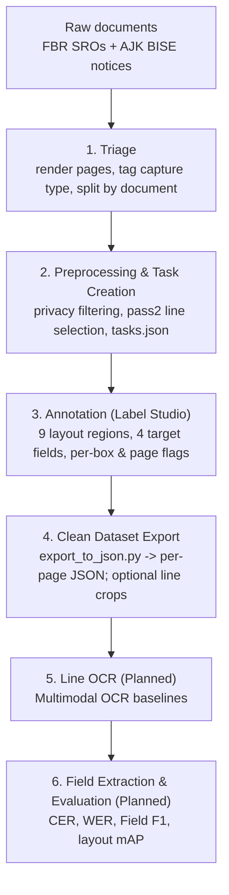

# Nastaliq Document Intelligence

Turn scanned Urdu notices (Nastaliq script) into structured records. For every page the pipeline extracts
**date, department, subject and reference number**, and links each value to its region in the original
image so a human can verify it.

> Course project, Group 2. Current stage: **Data Collection, Triage, and Complete Ground-Truth Annotation**.

## Pipeline overview



## Stages in detail

| # | Stage | Input | Output | Tool / status |
|---|---|---|---|---|
| 1 | **Triage** | PDFs and images in `Dataset/DOCS-PDFS` | `pages/images/*.png`, `pages/manifest.csv` (capture type `digital / scan / photo`, `low_res`, `year`, `split`, `annotate`) | `triage.py` (done) |
| 2 | **Task Creation** | `pages/manifest.csv`, `pages/review_personal_data.csv` | `tasks.json` (239 tasks: test, test_unseen, val, train; 120 pass2 line transcription tasks) | `make_tasks.py` (done) |
| 3 | **Annotation Setup & Guidelines** | `labelstudio_config.xml`, `annotation_guide.md` | Label Studio UI with 9 classes (`header_department`, `reference_no`, `date`, `subject`, `body`, `table`, `stamp_signature`, `distribution_list`, `text_line`), per-box flags, page flags | Label Studio (done) |
| 4 | **Ground-Truth Annotation** | `tasks.json`, page images | `export.json` (239 annotated tasks, verified coordinates and clean Nastaliq text) | Verified annotations (done) |
| 5 | **Dataset Export & Validation** | `export.json` | `Dataset/pages/*.json`, `Dataset/all_pages.jsonl`, `Dataset/report.txt`; line crops and `lines.tsv` are optional (`--crops`) | `export_to_json.py` (done, 0 warnings) |
| 6 | **Line OCR & Field Extraction** | crops and pages from stage 5 | Text per line, extracted fields (`date`, `department`, `subject`, `reference_no`) | *planned* |
| 7 | **Evaluation** | records + ground truth (`lines.tsv`) | CER, WER, layout mAP, field F1 | *planned* |

---

## Output record (one per page)

```json
{
  "page_id": "AJK_0001_p01",
  "file": "azad Kashmir\\0001_541442IMG_0066.jpg",
  "image": "pages/images/AJK_0001_p01.png",
  "width": 2108,
  "height": 3197,
  "source": "AJK",
  "type": "photo",
  "split": "train",
  "low_res": 0,
  "page_flags": [],
  "fields": {
    "department": {
      "region_id": "reg_1",
      "text": "آزاد جموں وکشمیر انٹر میڈیٹ و ثانوی تعلیمی بورڈ میرپور",
      "bbox": [419.1, 110.0, 1284.0, 95.9],
      "flags": []
    },
    "reference_no": {
      "region_id": "reg_3",
      "text": "8389-8400 / 2026",
      "bbox": [1380.0, 2009.0, 510.0, 71.9],
      "flags": ["handwritten"]
    },
    "date": {
      "region_id": "reg_4",
      "text": "12-11-2026",
      "bbox": [937.0, 2006.1, 350.0, 68.1],
      "flags": ["handwritten"]
    },
    "subject": {
      "region_id": "reg_2",
      "text": "پریس ریلیز!",
      "bbox": [1621.1, 220.0, 298.1, 117.0],
      "flags": ["implicit_subject"]
    }
  },
  "regions": [ ... ]
}
```

---

## Data

The raw documents are stored in `Dataset/DOCS-PDFS/`:

| Folder | Content | Type |
|---|---|---|
| `Dataset/DOCS-PDFS/FBR` | 12 Urdu SRO notifications of the Federal Board of Revenue | digital-born PDFs, clean |
| `Dataset/DOCS-PDFS/azad Kashmir` | 672 notices / press releases of the AJK Board of Intermediate and Secondary Education (2016-2026) | real scans, phone photos, CamScanner and WhatsApp images |

`Dataset/ajkbise_manifest.csv` lists the source URL and website date of every AJK file.

Splits (set by `triage.py`):

| Split | Content | Use |
|---|---|---|
| `train` | older AJK documents (129 pages) | layout model training, few-shot examples |
| `val` | next newest AJK documents (31 pages) | tuning prompts and rules |
| `test` | newest AJK documents, every capture type represented (49 pages) | final scores (manually verified pages) |
| `test_unseen` | FBR documents (30 pages) | unseen-issuer test |

---

## Repository layout

```
.
├── README.md                 # Project overview and roadmap
├── requirements.txt          # Clean dependencies for triage & annotation
├── outcomes.json             # Single outcome file: all 239 page annotations & fields
├── export.json               # Complete verified Label Studio annotations export
├── tasks.json                # 239 tasks for Label Studio import
├── labelstudio_config.xml    # Label Studio UI configuration (9 classes, flags)
├── annotation_guide.md       # Team annotation guidelines (Urdu / Roman Urdu)
├── make_tasks.py             # Generates tasks.json from manifest.csv
├── export_to_json.py         # Validates annotations -> clean dataset + report
├── download_ajkbise.py       # Scrapes AJK BISE notices
├── triage.py                 # Renders pages, tags capture type, splits by document
├── pages/                    # Triage outputs
│   ├── images/               # 789 rendered page PNG images
│   ├── manifest.csv          # Metadata manifest (splits, types, resolution)
│   └── review_personal_data.csv # Student privacy review list
└── Dataset/                  # Raw source documents & per-page ground truth
    ├── DOCS-PDFS/            # Raw PDFs and images (FBR, azad Kashmir)
    │   ├── azad Kashmir/     # 672 AJK BISE notices
    │   └── FBR/              # 12 FBR Urdu SROs
    ├── ajkbise_manifest.csv  # Source URLs and dates
    ├── scrape_failed.csv     # Scraper failed URLs log
    ├── pages/                # 239 clean per-page JSON records
    ├── all_pages.jsonl       # All page records in JSONL format
    └── report.txt            # Validation summary (0 warnings)
```

---

## Setup

```powershell
python -m venv venv
.\venv\Scripts\Activate.ps1
pip install -r requirements.txt
```

---

## How to run (up to Annotation)

1. **Triage:**
   ```powershell
   python triage.py --input Dataset/DOCS-PDFS --out pages
   ```
2. **Build Label Studio tasks:**
   ```powershell
   python make_tasks.py --manifest pages/manifest.csv --review pages/review_personal_data.csv --out tasks.json
   ```
3. **Export & Validate Dataset:**
   ```powershell
   python export_to_json.py --export export.json --out Dataset --doc-root . --crops
   ```
   Check `Dataset/report.txt` to verify field presence and warnings. Add `--crops` to generate `Dataset/lines/` and `Dataset/lines.tsv` for OCR training; the current export has no line crops.

---

## Status

- [x] Data collection (FBR Urdu SROs, AJK BISE notices)
- [x] Triage and document-level split
- [x] Label Studio XML configuration and team annotation guidelines
- [x] Ground-truth annotation of 239 pages (5,407 transcribed lines)
- [x] Export to clean structured dataset (`Dataset/pages/`, `Dataset/all_pages.jsonl`) with 0 warnings
- [ ] Generate line crops and `Dataset/lines.tsv` (`export_to_json.py --crops`)
- [ ] Baseline OCR (Tesseract / Multimodal models)
- [ ] Field extraction and normalization rules
- [ ] Evaluation (CER, WER, Layout mAP, Field F1)

---

## Team

- Aleena Ahmed
- Seerat Fatima
- Muhammad Adil
- Muhammad Omer
